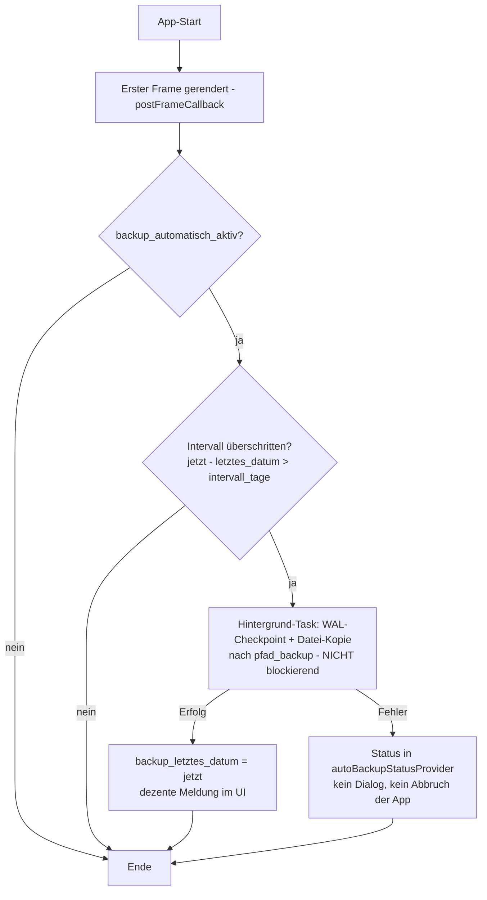

# Plan: Backup-Konzept – Datensicherung & Wiederherstellung

> **Status**: Entwurf
> **Erstellt**: 2026-10-13
> **Schema-Version**: 18 (KEINE Schema-Änderung – Stammdaten-Schlüssel + Dateisystem)
> **ADR**: [`plans/adr/ADR-003-backup-konzept.md`](adr/ADR-003-backup-konzept.md)
> **Basis**: bestehender [`DatabaseBackupService`](../lib/core/data/database_backup_service.dart:13)

---

## 1. Anforderungen

1. **Manuelles Backup** der SQLite-DB mit frei wählbarem Zielverzeichnis.
2. **Schedule**: einstellbares Intervall in **Tagen** für automatische Datensicherungen.
3. **Auto-Backup beim Start**: wenn seit dem letzten Backup ein längeres Intervall
   vergangen ist als eingestellt, läuft beim Start automatisch ein Backup.
4. **Hintergrund-Task**: stört das Arbeiten nicht (kein modal-Dialog, async IO,
   Start erst nach dem ersten gerenderten Frame).
5. **Konfigurierbares Verzeichnis** für automatische Backups; manuelles Backup
   mit gesonderter Verzeichniswahl.
6. **Eigener UI-Bereich „Sicherung & Wiederherstellung"** – komfortabel und ergonomisch.

---

## 2. Konfiguration (Stammdaten – KEIN Schema-Change)

Alle Einstellungen liegen im bestehenden key-value-Store [`stammdaten`](../lib/assets/data/structur.md:72).
Neue Schlüssel werden beim ersten Zugriff per `getOrCreate` angelegt
(`backup_intervall_tage`, `backup_automatisch_aktiv`, `backup_letztes_datum`).

| Schlüssel | Typ | Standard | Änderbar | Bedeutung |
|---|---|---|---|---|
| `pfad_backup` | string | *(leer – z. B. `<Dokumente>/ClupData/Backups`)* | ja | Zielverzeichnis der **automatischen** Backups |
| `backup_intervall_tage` | integer | `7` | ja | Intervall in Tagen zwischen zwei Sicherungen |
| `backup_automatisch_aktiv` | boolean | `1` | ja | Auto-Backup beim Start ein/aus |
| `backup_letztes_datum` | date | *(leer)* | **nein** | Zeitpunkt des letzten **erfolgreichen** Backups (manuell oder automatisch) |

**Intervall-Regel (Auto-Backup beim Start):**

```
fällig  ⇔  backup_automatisch_aktiv = 1
           UND (backup_letztes_datum leer
                ODER jetzt − backup_letztes_datum > backup_intervall_tage)
```

---

## 3. Backup-Ablauf



### 3.1 Manuell vs. automatisch

| | Manuell | Automatisch |
|---|---|---|
| Auslöser | Button im Screen / Menü / Tastenkürzel | App-Start (Intervall-Check) |
| Zielverzeichnis | **Frei wählbar** (Save-Dialog) | Immer `pfad_backup` |
| Dateiname | [`defaultBackupFileName()`](../lib/core/data/database_backup_service.dart:74) (`clup_data_backup_YYYY-MM-DD_HH-MM.sqlite`) | gleich |
| `backup_letztes_datum` | wird gesetzt | wird gesetzt |
| UI | Fortschritt im Screen | dezent (kein Dialog) |

### 3.2 Technik (unverändert aus [`DatabaseBackupService`](../lib/core/data/database_backup_service.dart:21))

1. `db.checkpoint()` – WAL-Cache in die Hauptdatei (Regel aus [`AGENTS.md`](../AGENTS.md))
2. `File(...).copy(ziel)` – reines Datei-IO, asynchron (nicht blockierend)
3. Rückgabe: Dateipfad + Größe für die Backup-Liste

---

## 4. Restore-Konzept

Bestehende [`DatabaseBackupService.restore()`](../lib/core/data/database_backup_service.dart:36)
bleibt die technische Basis (Sicherheitskopie `.bak`, DB schließen, Datei ersetzen,
Rollback bei Fehler).

**Ablauf im UI:**
1. Datei wählen (aus Backup-Liste ODER „Aus Datei wiederherstellen…")
2. **Bestätigungsdialog mit Warnung**: „Alle aktuellen Daten werden ersetzt.
   Eine Sicherheitskopie der aktuellen Datenbank wird automatisch erstellt."
3. Restore ausführen
4. `ref.invalidate(appDatabaseProvider)` – DB wird neu geöffnet
5. Meldung: „Wiederherstellung abgeschlossen. Bitte starten Sie die Anwendung neu."

> **Entscheidung**: Bewusst **kein** automatischer App-Neustart (`exit(0)`) –
> der Neustart-Hinweis ist schonender und deterministisch (siehe ADR-003).

---

## 5. UI: Screen „Sicherung & Wiederherstellung" (`screen_backup_restore`)

```
┌──────────────────────────────────────────────────────────────────────┐
│  Sicherung & Wiederherstellung                                        │
├──────────────────────────────────────────────────────────────────────┤
│  ┌─ Status ─────────────────────────────────────────────────────────┐ │
│  │  Letztes Backup: 12.10.2026 08:30 (automatisch)                  │ │
│  │  Intervall: 7 Tage · Nächstes fällig: 19.10.2026                 │ │
│  │  Auto-Verzeichnis: /home/user/Dokumente/ClupData/Backups          │ │
│  │  Status: ● Bereit / ● Datensicherung läuft… / ● Fehler: …         │ │
│  └──────────────────────────────────────────────────────────────────┘ │
│                                                                       │
│  [Jetzt sichern…]        [In Auto-Verzeichnis sichern]                │
│                                                                       │
│  ── Automatische Datensicherung ──────────────────────────────────    │
│  [x] Beim Programmstart automatisch sichern                           │
│  Intervall: [  7  ] Tage                                              │
│  Verzeichnis: [/home/user/…/Backups        ] [Ändern…]                │
│                                                                       │
│  ── Vorhandene Sicherungen ───────────────────────────────────────    │
│  ┌────────────────────────────┬────────────────┬────────┬──────────┐  │
│  │ Datei                      │ Erstellt am    │ Größe  │ Aktionen │  │
│  ├────────────────────────────┼────────────────┼────────┼──────────┤  │
│  │ clup_data_backup_2026-…    │ 12.10. 08:30   │ 2,1 MB │ [♻]      │  │
│  │ clup_data_backup_2026-…    │ 05.10. 08:30   │ 2,0 MB │ [♻]      │  │
│  └────────────────────────────┴────────────────┴────────┴──────────┘  │
│  [Aus Datei wiederherstellen…]                        [Aktualisieren]  │
└──────────────────────────────────────────────────────────────────────┘
```

**Elemente:**

| Element | Widget | Beschreibung |
|---|---|---|
| Status-Karte | `BackupStatusCard` | Letztes Backup (Datum/Uhrzeit + Art), nächstes Fälligkeitsdatum, Verzeichnis, Live-Status des Tasks |
| „Jetzt sichern…" | [`FilledButton`](../lib/common_widgets/app_edit_dialog_scaffold.dart:36) | Manuell mit **Verzeichniswahl** (Save-Dialog) |
| „In Auto-Verzeichnis sichern" | `OutlinedButton` | Sofort-Backup ins konfigurierte `pfad_backup` |
| Auto-Checkbox | `CheckboxListTile` | `backup_automatisch_aktiv` |
| Intervall | `TextField` (Zahl) | `backup_intervall_tage` (1–365) |
| Verzeichnis | `TextField` read-only + „Ändern…" | `pfad_backup` (Directory-Picker) |
| Backup-Liste | Spalten: Datei, Erstellt am, Größe, Aktionen | Scan des Auto-Verzeichnisses, sortiert nach Datum (neueste zuerst); „Wiederherstellen"-Aktion je Zeile |
| „Aus Datei wiederherstellen…" | `OutlinedButton` | Datei-Dialog für Backups außerhalb des Auto-Verzeichnisses |

---

## 6. Architektur

```
lib/features/backup/
├── data/
│   ├── backup_config_repository.dart   # NEU: Stammdaten getOrCreate/update (Intervall, Pfad, letztes Datum)
│   └── backup_verzeichnis_service.dart # NEU: Scan/Liste der Backup-Dateien
├── domain/
│   └── models/
│       └── backup_eintrag.dart         # NEU (@freezed: dateiname, datum, groesse, pfad)
├── presentation/
│   ├── backup_restore_screen.dart      # NEU (Screen)
│   ├── providers/
│   │   └── backup_providers.dart       # NEU (@riverpod: Config, Liste, AutoBackupStatus)
│   └── widgets/
│       ├── backup_status_card.dart     # NEU
│       └── backup_liste.dart           # NEU
└── services/
    └── backup_scheduler_service.dart   # NEU: Intervall-Check + Hintergrund-Backup

lib/core/data/database_backup_service.dart   # BLEIBT (technische Basis)
lib/common_widgets/database_backup_dialog.dart # BLEIBT (Menü-Shortcuts nutzen ihn weiter)
```

### 6.1 Service-API (Pseudocode)

```dart
/// Koordiniert Auto-Backup und Config (Facade über DatabaseBackupService).
class BackupSchedulerService {
  /// Prüft das Intervall und startet ggf. ein Hintergrund-Backup.
  /// Läuft asynchron, blockiert die UI nicht, wirft keine Exceptions.
  Future<void> pruefeUndStarteAutoBackup();

  /// Manuelles Backup: checkpoint + Kopie nach [zielPfad],
  /// setzt backup_letztes_datum.
  Future<BackupErgebnis> backupManuell({required String zielPfad});

  /// Wiederherstellung via DatabaseBackupService.restore() + Provider-Reset.
  Future<void> restore(String quellPfad);
}
```

### 6.2 Provider

| Provider | Typ | Zweck |
|---|---|---|
| `backupConfigRepositoryProvider` | `@riverpod` | Config-Zugriff (Stammdaten) |
| `backupConfigProvider` | `@riverpod Future` | Intervall, Auto-Flag, Pfad, letztes Datum |
| `backupEintraegeProvider` | `@riverpod Future` | Liste aus dem Auto-Verzeichnis |
| `autoBackupStatusProvider` | `@riverpod class` | `idle` / `running` / `success(DateTime)` / `error(String)` – für die dezente Statusanzeige |
| `backupSchedulerProvider` | `@riverpod` | Scheduler-Instanz |

---

## 7. Testplan

| Test | Inhalt |
|---|---|
| `test/features/backup/backup_config_repository_test.dart` | getOrCreate-Defaults, Intervall-Update, `backup_letztes_datum` (nur intern änderbar) |
| `test/features/backup/backup_scheduler_service_test.dart` | Intervall-Check (fällig/nicht fällig/deaktiviert/kein Datum), Backup schreibt Datei + setzt Datum, Fehlerpfad |
| `test/features/backup/backup_verzeichnis_service_test.dart` | Scan (nur `clup_data_backup_*.sqlite`), Sortierung, Größen/Datum, leeres/fehlendes Verzeichnis |

---

## 8. Offene Punkte

| # | Frage | Entscheidung |
|---|---|---|
| 1 | Aufbewahrung (max. Anzahl Backups, Rotation)? | Nicht Teil dieser Anforderung – später ergänzbar |
| 2 | Alte Dialoge (`showBackupDialog`) entfernen? | Nein – bleiben als Schnellzugriff über Menü/Tastenkürzel, öffnen künftig den Screen |
| 3 | Backup-Liste auch für manuelle Backups? | Nein – Liste zeigt `pfad_backup`; manuelle Backups liegen im frei gewählten Verzeichnis |
