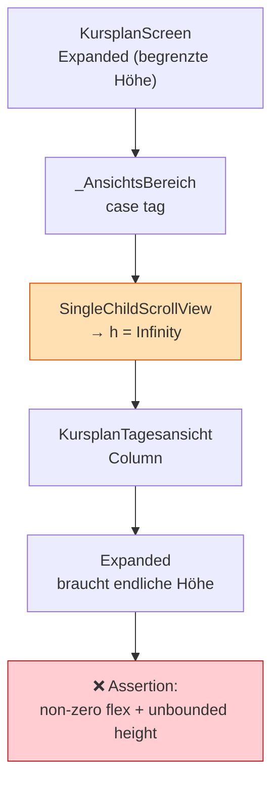

# Plan: Fix – RenderFlex-Fehler in der Kursplan-Tagesansicht

> **Status**: Vorgeschlagen
> **Erstellt**: 2026-10-15
> **Betroffen**: [`lib/features/calendar/presentation/widgets/kursplan_tagesansicht.dart`](../lib/features/calendar/presentation/widgets/kursplan_tagesansicht.dart:1), [`lib/features/calendar/presentation/kursplan_screen.dart`](../lib/features/calendar/presentation/kursplan_screen.dart:1)
> **Bezug**: [`ADR-007`](adr/ADR-007-kursplan-ueberlappungs-layout.md:1), [`ADR-008`](adr/ADR-008-kursplan-scroll-verantwortung.md:1), [`plans/kursplan.md`](kursplan.md:1)
> **Schema-Auswirkung**: keine (reiner UI-Fix)

---

## 1. Symptom

Beim Start der App (Route `/calendar`, Ansicht **Tag**) bricht das Rendering ab:

```
RenderFlex children have non-zero flex but incoming height constraints are unbounded.
The relevant error-causing widget was:
  Column  Column:.../kursplan_tagesansicht.dart:38:12
```

In der Folge kaskadieren Sekundärfehler (`RenderBox was not laid out`,
`Cannot hit test a render box with no size`, `mouse_tracker`-Assertions) und die
App verliert die Verbindung (`Lost connection to device`).

---

## 2. Ursachenanalyse

### 2.1 Kernursache: `Expanded` in unbounded Höhe

[`KursplanTagesansicht.build()`](../lib/features/calendar/presentation/widgets/kursplan_tagesansicht.dart:31)
liefert eine [`Column`](../lib/features/calendar/presentation/widgets/kursplan_tagesansicht.dart:38)
mit einem [`Expanded`](../lib/features/calendar/presentation/widgets/kursplan_tagesansicht.dart:50).
`Expanded` verlangt eine **begrenzte** Höhe des Elternteils.

Der Aufrufer wickelt die Tagesansicht jedoch in einen
[`SingleChildScrollView`](../lib/features/calendar/presentation/kursplan_screen.dart:275):

```dart
case KursplanAnsicht.tag:
  return SingleChildScrollView(
    child: KursplanTagesansicht(tag: zustand.fokus, termine: termine),
  );
```

Ein `SingleChildScrollView` gibt seinem Kind **unbegrenzte** Höhe
(`0.0 <= h <= Infinity`). Damit sind die beiden Direktiven
„shrink-wrap" (ScrollView) und „expand to fill" (`Expanded`) unvereinbar →
Assertion.

### 2.2 Sekundärproblem: Doppeltes Scrollen

Die Tagesansicht bringt bereits einen **eigenen** Scroll-Viewport mit
([`SingleChildScrollView`](../lib/features/calendar/presentation/widgets/kursplan_tagesansicht.dart:51)
über einer [`SizedBox(height: 960)`](../lib/features/calendar/presentation/widgets/kursplan_tagesansicht.dart:52)).
Der äußere ScrollView im Screen ist daher nicht nur schädlich, sondern auch
**redundant**: Der Zeitstrahl scrollt bereits intern.

### 2.3 Ablaufdiagramm



### 2.4 Vergleich Wochenansicht (funktioniert)

Die Wochenansicht nutzt denselben äußeren `SingleChildScrollView`
([`kursplan_screen.dart:265`](../lib/features/calendar/presentation/kursplan_screen.dart:265)),
ist aber **korrekt**, weil das [`KursplanWochenGrid`](../lib/features/calendar/presentation/widgets/kursplan_wochen_grid.dart:1)
eine **feste** Höhe besitzt und **kein** `Expanded` verwendet. Der ScrollView
ist dort also legitim und muss erhalten bleiben.

---

## 3. Entscheidung

**Die Scroll-Verantwortung liegt beim inneren Widget (Tagesansicht), nicht beim
Screen.** Der äußere `SingleChildScrollView` für die Tagesansicht wird entfernt;
die Tagesansicht erhält die begrenzte Höhe aus dem umgebenden
[`Expanded`](../lib/features/calendar/presentation/kursplan_screen.dart:55) und
scrollt über ihren eigenen Viewport.

### 3.1 Konkreter Fix (Pseudocode / Diff-Beschreibung)

**Datei:** [`lib/features/calendar/presentation/kursplan_screen.dart`](../lib/features/calendar/presentation/kursplan_screen.dart:273)

```dart
// VORHER (fehlerhaft)
case KursplanAnsicht.tag:
  // Zeitstrahl hat feste Höhe – ebenfalls scrollierbar.
  return SingleChildScrollView(
    child: KursplanTagesansicht(tag: zustand.fokus, termine: termine),
  );

// NACHHER (korrekt)
case KursplanAnsicht.tag:
  // Die Tagesansicht bringt einen eigenen Scroll-Viewport mit und erwartet
  // eine BEGRENZTE Höhe (Expanded). Daher KEIN äußerer SingleChildScrollView.
  return KursplanTagesansicht(tag: zustand.fokus, termine: termine);
```

**Datei:** [`lib/features/calendar/presentation/widgets/kursplan_tagesansicht.dart`](../lib/features/calendar/presentation/widgets/kursplan_tagesansicht.dart:38)

Keine strukturelle Änderung nötig. Optional zur Absicherung:

- Der innere [`SingleChildScrollView`](../lib/features/calendar/presentation/widgets/kursplan_tagesansicht.dart:51)
  bleibt der einzige Scroll-Viewport.
- Die feste Höhe `(_endStunde - _startStunde) * 60.0` (960 px) bleibt als
  Inhaltshöhe des Zeitstrahls erhalten.

### 3.2 Warum nicht die Alternative „Tagesansicht defensiv machen"?

Man könnte die Tagesansicht so umbauen, dass sie auch in unbounded-Kontext
funktioniert (z. B. `mainAxisSize: MainAxisSize.min` + `Flexible` statt
`Expanded`). Das wurde **verworfen**, weil:

- es das doppelte Scrollen (2.2) nicht behebt,
- die Tagesansicht dann ihre Höhe nicht mehr an den verfügbaren Platz anpassen
  kann (der Zeitstrahl würde immer 960 px hoch sein, auch bei kleinem Fenster),
- die Verantwortlichkeit unklar bliebe (Screen vs. Widget).

---

## 4. Betroffene Dateien

| Datei | Änderung | Risiko |
|---|---|---|
| [`kursplan_screen.dart`](../lib/features/calendar/presentation/kursplan_screen.dart:273) | `SingleChildScrollView` im `case tag` entfernen | gering |
| [`kursplan_tagesansicht.dart`](../lib/features/calendar/presentation/widgets/kursplan_tagesansicht.dart:1) | `StatelessWidget` → `HookWidget`, initialer Scroll-Offset (15:00) | gering |
| [`kursplan_wochen_grid.dart`](../lib/features/calendar/presentation/widgets/kursplan_wochen_grid.dart:1) | keine (Wochenansicht bleibt unverändert) | keins |

---

## 5. Verifikation

1. **Manuell**: App starten, Route `/calendar` öffnen, Ansicht auf **Tag**
   umschalten → kein RenderFlex-Fehler, Zeitstrahl scrollt.
2. **Fenster-Resize**: Fenster stark verkleinern → Zeitstrahl bleibt scrollbar,
   kein Overflow.
3. **Leere Daten**: Tag ohne Termine → Hinweis „Keine Kurse an diesem Tag."
   sichtbar, Zeitstrahl bleibt.
4. **Statische Analyse**: `flutter analyze` ohne neue Warnungen.
5. **Regression Wochenansicht**: Ansicht **Woche** prüfen → unverändert
   scrollbar (äußerer ScrollView bleibt dort bestehen).

### 5.1 Empfohlener Widget-Test

```dart
// test/features/calendar/kursplan_tagesansicht_test.dart (Pseudocode)
testWidgets('Tagesansicht rendert in begrenzter Höhe ohne Overflow', (tester) async {
  await tester.pumpWidget(
    MaterialApp(
      home: Scaffold(
        body: SizedBox(
          height: 600, // begrenzte Höhe wie im Screen-Expanded
          child: KursplanTagesansicht(tag: DateTime(2026, 10, 15), termine: const []),
        ),
      ),
    ),
  );
  expect(tester.takeException(), isNull);
});
```

---

## 6. Konsequenzen

- **Positiv**: RenderFlex-Fehler behoben; kein doppeltes Scrollen; klare
  Verantwortlichkeit (Widget scrollt selbst); Wochenansicht unberührt.
- **Negativ / Aufwand**: minimal (eine Zeile im Screen).
- **Neutral**: Öffentliche Signaturen, Route `/calendar` und Datenmodell
  bleiben unverändert; keine Schema-/Migrationsänderung.

---

## 7. Umsetzungsauftrag (für Flutter-Dev-Mode)

1. In [`kursplan_screen.dart`](../lib/features/calendar/presentation/kursplan_screen.dart:273)
   den `SingleChildScrollView` im `case KursplanAnsicht.tag` entfernen und
   `KursplanTagesansicht` direkt zurückgeben.
2. Kommentar anpassen (Scroll-Verantwortung dokumentieren).
3. In [`kursplan_tagesansicht.dart`](../lib/features/calendar/presentation/widgets/kursplan_tagesansicht.dart:1)
   den initialen Scroll-Offset gemäß Abschnitt 8 umsetzen.
4. `flutter analyze` ausführen.
5. Optional: Widget-Test gemäß 5.1 ergänzen.

---

## 8. Erweiterung: Initialer Scroll-Offset (15:00 Uhr oben)

### 8.1 Anforderung

Beim Öffnen der Tagesansicht soll der Zeitstrahl **initial bei 15:00 Uhr**
stehen, da die Kurse überwiegend abends stattfinden und so ohne manuelles
Scrollen sichtbar sind. Der Zeitstrahl selbst bleibt weiterhin von
**06:00–22:00** definiert (Morgenkurse bleiben erreichbar).

### 8.2 Lösung: `useScrollController` mit `initialScrollOffset`

Die Tagesansicht wird von `StatelessWidget` zu **`HookWidget`** (flutter_hooks)
umgebaut – konform zur Projektregel „nie `StatefulWidget`". Der Controller wird
per [`useScrollController()`](lib/features/calendar/presentation/widgets/kursplan_tagesansicht.dart:1)
einmalig erzeugt und automatisch disposed.

```dart
// kursplan_tagesansicht.dart (Pseudocode)
import 'package:flutter_hooks/flutter_hooks.dart';

class KursplanTagesansicht extends HookWidget {
  static const _startStunde = 6;
  static const _endStunde = 22;

  /// Stunde, die beim Öffnen oben sichtbar ist.
  static const _initialStunde = 15;

  @override
  Widget build(BuildContext context) {
    final scrollController = useScrollController(
      initialScrollOffset: (_initialStunde - _startStunde) * 60.0, // 540 px
    );

    return Column(
      crossAxisAlignment: CrossAxisAlignment.stretch,
      children: [
        // ... Kopfzeile (Datum) unverändert ...
        Expanded(
          child: SingleChildScrollView(
            controller: scrollController, // ← neu
            child: SizedBox(
              height: (_endStunde - _startStunde) * 60.0, // 960 px
              // ... Stack unverändert ...
            ),
          ),
        ),
      ],
    );
  }
}
```

### 8.3 Verhalten und Randfälle

| Fall | Verhalten |
|---|---|
| Fensterhöhe < 420 px | Offset 540 px wird auf `maxScrollExtent` geclampt → 15:00 so weit wie möglich oben |
| Fensterhöhe ≥ 960 px | Kein Scrollbedarf; gesamter Zeitstrahl sichtbar (15:00 mittig) |
| Ansichtswechsel Tag → Woche → Tag | Widget wird neu gemountet → Offset startet erneut bei 15:00 |
| Tageswechsel innerhalb der Tagesansicht | Widget bleibt gemountet → Scroll-Position bleibt erhalten (bewusst) |

> **Hinweis zum Clamping**: `initialScrollOffset` wird von Flutter automatisch
> auf den gültigen Bereich `[0, maxScrollExtent]` begrenzt. Bei großen Fenstern
> ist kein Scrollen nötig, sodass die Anforderung „15:00 oben" dort implizit
> erfüllt ist (alles sichtbar).

### 8.4 Alternative (verworfen)

- **`_startStunde` auf 12 oder 14 setzen**: Würde Morgenkurse abschneiden und
  die Datenbasis verfälschen – abgelehnt.
- **`ScrollController` als Feld im `StatelessWidget`**: Controller würde bei
  jedem Rebuild neu erzeugt und nie disposed (Leak) – abgelehnt.
- **`StatefulWidget` mit `initState`**: Verstößt gegen die Projektregel
  („nie `StatefulWidget`") – abgelehnt.

### 8.5 Verifikation (zusätzlich zu Abschnitt 5)

1. Tagesansicht öffnen → oberste sichtbare Stunde ist **15:00** (bei
   ausreichend kleinem Fenster).
2. Nach oben scrollen → Morgenkurse (ab 06:00) weiterhin erreichbar.
3. Fenster stark vergrößern → gesamter Zeitstrahl sichtbar, kein Fehler.
