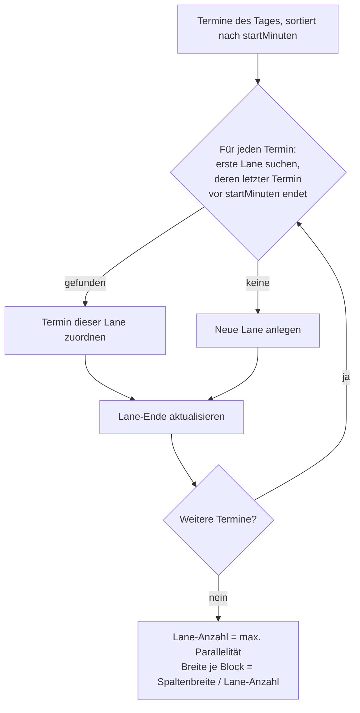
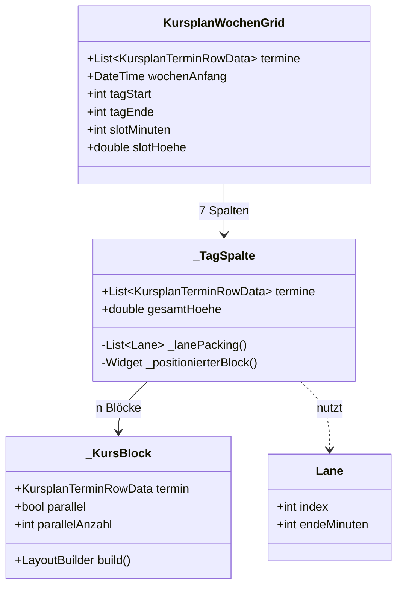

# Plan: Kursplan – Fehler bei gleichzeitigen Kursen beheben & Überlappungs-Darstellung verbessern

> **Status**: Entwurf
> **Erstellt**: 2026-10-15
> **Betroffene Menüpunkte**: Kursplan (Route `/calendar`)
> **Betroffene Dateien**: [`kursplan_wochen_grid.dart`](../lib/features/calendar/presentation/widgets/kursplan_wochen_grid.dart:1), [`kursplan_tagesansicht.dart`](../lib/features/calendar/presentation/widgets/kursplan_tagesansicht.dart:1)
> **Schema-Version**: unverändert (**19**) – reine UI-/Layout-Änderung, **keine Migration**
> **ADR**: [`plans/adr/ADR-007-kursplan-ueberlappungs-layout.md`](adr/ADR-007-kursplan-ueberlappungs-layout.md)
> **Basis**: [`plans/kursplan.md`](kursplan.md), [`ADR-002`](adr/ADR-002-kursplan-schema.md)

---

## 1. Problembeschreibung

Sobald **zwei Kurse am selben Wochentag zur selben Zeit** stattfinden (z. B. „Boxen Erwachsene"
und „Kickboxen" parallel in zwei Hallen), meldet die Wochenansicht einen **Layout-Fehler**
(RenderFlex-Overflow, gelb-schwarze Warnstreifen + Konsolenfehler
`A RenderFlex overflowed by X pixels on the bottom`). Der Fehler tritt **nur** bei
überlappenden Terminen auf – bei rein sequenziellen Terminen bleibt die Ansicht fehlerfrei.

---

## 2. Root-Cause-Analyse

### 2.1 Primärursache – fester Block-Inhalt bei halbierter Breite

Der Kursblock [`_KursBlock`](../lib/features/calendar/presentation/widgets/kursplan_wochen_grid.dart:217)
rendert **immer** zwei Textzeilen (Kursname `maxLines: 2` + Zeitbereich `maxLines: 1`) in einer
`Column` – unabhängig von der verfügbaren Höhe/Breite:

```dart
// Pseudocode – IST-Zustand
Column(children: [
  Text(kursName, maxLines: 2, fontSize: 11),   // kann 2 Zeilen belegen
  Text('HH:mm–HH:mm', maxLines: 1, fontSize: 10),
])
```

Der Block wird in [`_positionierterBlock()`](../lib/features/calendar/presentation/widgets/kursplan_wochen_grid.dart:170)
mit **fester Höhe** positioniert:

```dart
// Pseudocode – IST-Zustand
height = (endSlot - startSlot) * slotHoehe;   // 1 Slot = 30 px
width  = spaltenBreite / spaltenAnzahl - 2;   // bei 2 Kursen: halbe Breite
```

**Zahlenbeispiel (30-Minuten-Kurs, 2 parallele Kurse):**

| Größe | Wert |
|---|---|
| Blockhöhe (1 Slot) | 30 px |
| − Margin (2 × 1 px) | 28 px |
| − Padding (2 × 3 px) | **22 px nutzbar** |
| Benötigt: Name (2 Zeilen × ~13 px) + Zeit (~12 px) | **~38 px** |

→ **22 px < 38 px ⇒ Overflow.** Die halbierte Breite erzwingt zusätzlich den Umbruch des
Kursnamens auf 2 Zeilen und verschärft damit den vertikalen Platzmangel.

### 2.2 Sekundärursache – naive Überlappungs-Gruppierung

[`_ueberlappungsGruppen()`](../lib/features/calendar/presentation/widgets/kursplan_wochen_grid.dart:195)
fasst **alle transitiv** überlappenden Termine zu **einer** Gruppe zusammen und teilt die
Spaltenbreite **gleichmäßig** auf alle Gruppenmitglieder auf:

```dart
// Pseudocode – IST-Zustand
for (final gruppe in _ueberlappungsGruppen())
  for (var idx = 0; idx < gruppe.length; idx++)
    block(gruppe[idx], spaltenIndex: idx, spaltenAnzahl: gruppe.length);
```

**Problem:** Nicht alle Mitglieder einer Gruppe überlappen sich gegenseitig. Beispiel
A `16:00–18:00`, B `17:00–19:00`, C `18:30–20:00` → eine Gruppe mit 3 Spalten, obwohl
A und C **nie gleichzeitig** laufen. Folge: unnötig schmale Blöcke (1/3 statt 1/2 Breite),
was den Overflow aus 2.1 weiter begünstigt.

### 2.3 Weitere Schwachstellen

| # | Schwachstelle | Auswirkung |
|---|---|---|
| 1 | Negative/Null-Breite bei ≥ 3 Überlappungen in schmalem Fenster (`spaltenBreite / n - 2 ≤ 0`) | BoxConstraints-Fehler / unsichtbare Blöcke |
| 2 | Kein Clamping der Zeitachse: Termine vor 06:00 / nach 22:00 erzeugen `startSlot < 0` bzw. `endSlot > slotAnzahl` | Blöcke außerhalb des Rasters / abgeschnitten |
| 3 | Kein Hinweis, **dass** Kurse parallel laufen | Nutzer kann Parallelität nicht erkennen |
| 4 | Kein Tooltip mit vollständigen Details (Kampfsportart, parallele Kurse) | Information nur eingeschränkt lesbar |

---

## 3. Lösungsstrategie

### 3.1 Layout-Algorithmus: Greedy-Lane-Packing (Intervall-Partitionierung)

Statt „alle Überlappenden gleich breit" wird jeder Termin der **ersten freien Spur (Lane)**
zugewiesen, in der er mit keinem bereits platzierten Termin kollidiert. Nicht überlappende
Termine teilen sich eine Spur → **maximale Breite**, minimaler Overflow.



**Ergebnis im Beispiel A/B/C:** A → Lane 0, B → Lane 1, C → Lane 0 (A ist beendet).
→ 2 Spuren statt 3, C erhält wieder volle halbe Breite.

### 3.2 Responsiver Block-Inhalt

Der Block entscheidet per `LayoutBuilder` anhand der **verfügbaren Höhe und Breite**, was
gerendert wird – so kann kein Overflow mehr entstehen:

| Verfügbare Höhe | Verfügbare Breite | Darstellung |
|---|---|---|
| ≥ 2 Slots (≥ 60 px) | ≥ 90 px | Kursname (max. 2 Zeilen) **+** Zeitbereich |
| ≥ 2 Slots | < 90 px | Kursname (max. 2 Zeilen), Zeit als Tooltip |
| 1 Slot (30 px) | beliebig | Kursname **1 Zeile**, Ellipsis; Zeit nur im Tooltip |
| < 1 Slot | beliebig | Nur Farbfläche + Tooltip (kein Text) |

Zusätzlich: `ClipRect` um den Blockinhalt als **Sicherheitsnetz**, damit selbst bei
Grenzfällen kein Overflow-Banner erscheint.

### 3.3 Parallel-Indikator & Tooltip

- **Parallel-Badge**: Läuft ein Termin gleichzeitig mit mindestens einem anderen, zeigt der
  Block ein kleines Symbol (z. B. `Icons.people_alt_outlined` bzw. „∥") in der Ecke.
- **Tooltip** (`Tooltip`-Widget) auf jedem Block mit vollständigen Details:
  Kursname, Kampfsportart, Zeitbereich und – falls vorhanden – Liste der **parallel laufenden
  Kurse**.
- **Legende**: Kurse, die im aktuellen Plan parallel laufen, werden in der
  [`KursplanLegende`](../lib/features/calendar/presentation/widgets/kursplan_legende.dart:10)
  mit demselben Parallel-Symbol markiert.

### 3.4 Zeitachsen-Clamping

`startSlot`/`endSlot` werden auf `[0, slotAnzahl]` begrenzt. Termine außerhalb des
Anzeigefensters (06:00–22:00) werden am Rand „angedockt" und im Tooltip als
„außerhalb des Anzeigebereichs" gekennzeichnet.

---

## 4. UI-Konzept (verbessert)

### 4.1 Vorher / Nachher

```
VORHER (Fehler bei 2 parallelen Kursen)          NACHHER (Lane-Packing + responsiv)
┌──────────────┬──────────────┐                  ┌──────────────┬──────────────┐
│  Montag      │              │                  │  Montag      │              │
│ ┌──────────┐ │              │                  │ ┌──────────┐ │              │
│ │Boxen     │ │              │  ← Overflow      │ │Boxen ∥   │ │              │
│ │Erwachsene│ │              │    (2 Zeilen     │ │16:00–18:00│ │              │
│ │16:00–18:0│ │              │     in 22 px)    │ └──────────┘ │              │
│ └──────────┘ │              │                  │ ┌──────────┐ │              │
│ ┌──────────┐ │              │                  │ │Kickboxen∥│ │              │
│ │Kickboxen │ │              │                  │ │16:00–17:30│ │              │
│ └──────────┘ │              │                  │ └──────────┘ │              │
└──────────────┴──────────────┘                  └──────────────┴──────────────┘
```

### 4.2 Komponenten-Übersicht



### 4.3 Schnittstellen (Pseudocode – keine Implementierung)

```dart
/// Ergebnis der Lane-Zuweisung eines Termins.
class TerminPlatzierung {
  final KursplanTerminRowData termin;
  final int laneIndex;      // 0-basiert
  final int laneAnzahl;     // Gesamtzahl Spuren im Tag
  final int parallelAnzahl; // Anzahl gleichzeitig laufender Termine (inkl. diesem)
}

/// Verteilt Termine eines Tages auf Spuren (Greedy-Intervall-Partitionierung).
/// - sortiert nach startMinuten
/// - weist jedem Termin die erste Spur zu, deren letzter Termin
///   vor `startMinuten` endet; sonst neue Spur
/// - `parallelAnzahl` = Anzahl Termine mit echtem Zeit-Overlap
List<TerminPlatzierung> berechnePlatzierungen(List<KursplanTerminRowData> termine);

/// Reine, testbare Hilfsfunktion: überlappen sich zwei Termine zeitlich?
bool ueberlappt(KursplanTerminRowData a, KursplanTerminRowData b);
```

> **Hinweis:** Die Layout-Logik (`berechnePlatzierungen`, `ueberlappt`) wird als **reine
> Funktion** aus dem Widget herausgezogen (z. B. nach
> `lib/features/calendar/domain/kursplan_layout.dart`), damit sie ohne Widget-Test
> unit-testbar ist.

---

## 5. Betroffene Dateien

| Datei | Änderung |
|---|---|
| [`kursplan_wochen_grid.dart`](../lib/features/calendar/presentation/widgets/kursplan_wochen_grid.dart:1) | Lane-Packing statt Gruppen-Split; responsiver `_KursBlock`; Parallel-Badge; Tooltip; Zeit-Clamping |
| `lib/features/calendar/domain/kursplan_layout.dart` | **NEU**: reine Layout-Funktionen (`berechnePlatzierungen`, `ueberlappt`) |
| [`kursplan_tagesansicht.dart`](../lib/features/calendar/presentation/widgets/kursplan_tagesansicht.dart:1) | Parallele Termine nebeneinander statt übereinander (gleiche Lane-Logik); Tooltip |
| [`kursplan_legende.dart`](../lib/features/calendar/presentation/widgets/kursplan_legende.dart:1) | Optional: Parallel-Symbol für parallel laufende Kurse |
| [`structur.md`](../lib/assets/data/structur.md:706) | UI-Doku `wochen_raster` um Überlappungs-Darstellung ergänzen |

**Keine** Änderung an: Datenbankschema, Repository, Providern, Dialogen, Migrationen.

---

## 6. Testplan

| Test | Inhalt |
|---|---|
| `test/features/calendar/kursplan_layout_test.dart` | `ueberlappt()`: Grenzfälle (Ende == Start = kein Overlap, offenes Ende); `berechnePlatzierungen()`: 2 identische Termine → 2 Lanes; A/B/C-Beispiel → 2 Lanes; sequenzielle Termine → 1 Lane; `parallelAnzahl` korrekt |
| `test/features/calendar/kursplan_wochen_grid_test.dart` | Widget-Test: 2 parallele Kurse rendern **ohne** Overflow (`tester.takeException()` == null); 30-Min-Block zeigt nur Name; Tooltip enthält parallele Kurse |
| `test/features/calendar/kursplan_tagesansicht_test.dart` | 2 parallele Termine werden nebeneinander (nicht überlappend) positioniert |

---

## 7. Umsetzungsreihenfolge

1. **SSOT** [`structur.md`](../lib/assets/data/structur.md:706) aktualisieren (UI-Doku).
2. Reine Layout-Funktionen `kursplan_layout.dart` + Unit-Tests.
3. `_KursBlock` responsiv machen (Overflow beheben) + Widget-Test.
4. Lane-Packing in `_TagSpalte` integrieren.
5. Parallel-Badge + Tooltip ergänzen.
6. Tagesansicht angleichen.
7. `flutter analyze` + `flutter test` (Code-Mode).

---

## 8. Offene Punkte

| # | Frage | Vorschlag |
|---|---|---|
| 1 | Sollen parallele Kurse als „Konflikt" gewertet werden (Warnung im Editor)? | Nein – parallele Kurse sind legitim (mehrere Hallen). Nur visuell kennzeichnen. |
| 2 | Maximale Anzahl gleichzeitig dargestellter Spuren? | Ab 4 Spuren Blöcke auf Mindestbreite begrenzen und horizontal scrollen. |
| 3 | Raum/Trainer als Feld ergänzen? | Nicht Teil dieses Plans (siehe [`plans/kursplan.md`](kursplan.md:241) offener Punkt 2). |
