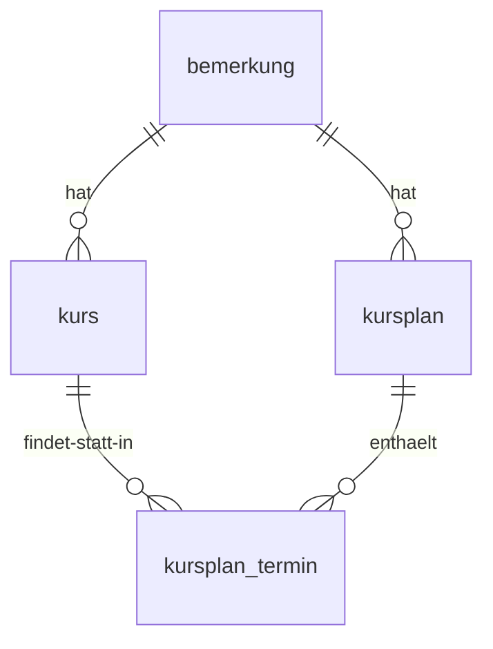

# Plan: Kursplan – Datenschema & UI

> **Status**: Entwurf
> **Erstellt**: 2026-10-12
> **Betroffene Menüpunkte**: Kursplan (Route `/calendar`)
> **Schema-Version**: 17 → **18** (Migration forward-only)
> **ADR**: [`plans/adr/ADR-002-kursplan-schema.md`](adr/ADR-002-kursplan-schema.md)

---

## 1. Anforderungen

1. Wochenplan-Tabelle: Welche Kurse finden an welchen Wochentagen statt –
   **Uhrzeiten eindeutig sichtbar**.
2. Kurse können sich ändern → **mehrere Kurspläne**, jeder gültig für einen
   **Zeitbereich** (mindestens eine Woche).
3. **Navigation durch Wochen** – je Woche wird der gültige Kursplan angezeigt.
4. Jeder **Kurstyp** (in einer Kampfsportart) ist **farblich eindeutig** gekennzeichnet.

---

## 2. Datenschema (Schema v18)



### 2.1 Tabelle `kurs` (Kurstyp/Kursangebot)

| Feld | Typ | Constraint | Beschreibung |
|---|---|---|---|
| `id` | INTEGER | PK autoincrement | |
| `uuid` | TEXT | unique, clientDefault `generateUuid()` | CSV-Export/Import |
| `name` | TEXT(100) | NOT NULL | z. B. „Boxen Erwachsene" |
| `kampfsportart` | TEXT(100) | NOT NULL | z. B. „Boxen", „Kickboxen", „MMA" |
| `farbe` | TEXT(9) | NOT NULL | Hex `#RRGGBB` – farbliche Kennzeichnung |
| `bemerkung_id` | INTEGER | FK → `bemerkung` (SET NULL) | |

### 2.2 Tabelle `kursplan` (Plan mit Gültigkeitszeitraum)

| Feld | Typ | Constraint | Beschreibung |
|---|---|---|---|
| `id` | INTEGER | PK autoincrement | |
| `uuid` | TEXT | unique, clientDefault `generateUuid()` | |
| `name` | TEXT(100) | NOT NULL | z. B. „Winterplan 2026/27" |
| `gueltig_von` | DATE | NOT NULL | erste gültige Woche (wird auf **Montag** normalisiert) |
| `gueltig_bis` | DATE | NULL | letzte gültige Woche; NULL = unbegrenzt |
| `bemerkung_id` | INTEGER | FK → `bemerkung` (SET NULL) | |

### 2.3 Tabelle `kursplan_termin` (wöchentliche Termine)

| Feld | Typ | Constraint | Beschreibung |
|---|---|---|---|
| `id` | INTEGER | PK autoincrement | |
| `uuid` | TEXT | unique, clientDefault `generateUuid()` | |
| `kursplan_id` | INTEGER | NOT NULL, FK → `kursplan` (**CASCADE**) | Löschen des Plans entfernt Termine |
| `kurs_id` | INTEGER | NOT NULL, FK → `kurs` (**RESTRICT**) | Kurs mit Terminen nicht löschbar |
| `wochentag` | INTEGER | NOT NULL | 1 = Montag … 7 = Sonntag |
| `startzeit` | TEXT(5) | NOT NULL | Format `HH:mm` |
| `endezeit` | TEXT(5) | NULL | Format `HH:mm`; NULL = offenes Ende |
| CHECK | | `endezeit IS NULL OR endezeit > startzeit` | |

### 2.4 Indizes

| Tabelle | Index | Spalten | Unique |
|---|---|---|---|
| `kurs` | `idx_kurs_name` | `name` | Nein |
| `kurs` | `idx_kurs_uuid` | `uuid` | Ja |
| `kursplan` | `idx_kursplan_gueltig` | `gueltig_von, gueltig_bis` | Nein |
| `kursplan` | `idx_kursplan_uuid` | `uuid` | Ja |
| `kursplan_termin` | `idx_kursplan_termin_plan` | `kursplan_id` | Nein |
| `kursplan_termin` | `idx_kursplan_termin_kurs` | `kurs_id` | Nein |
| `kursplan_termin` | `idx_kursplan_termin_uuid` | `uuid` | Ja |

### 2.5 Geschäftsregeln

| Regel | Umsetzung |
|---|---|
| Normalisierung `gueltig_von`/`gueltig_bis` auf Wochenanfang (Montag) | Repository beim Speichern (`montagVon()`) |
| „Mindestens eine Woche" | `gueltig_bis` ≥ `gueltig_von` (Validierung im Dialog) |
| Plan-Ermittlung für eine Woche | `gueltig_von <= montag` UND (`gueltig_bis IS NULL` ODER `gueltig_bis >= montag`) |
| Überschneidung zweier Pläne | Plan mit dem **spätesten `gueltig_von`** gewinnt; UI zeigt Auswahl-Dropdown |
| Zeitspeicherung | TEXT `HH:mm` – lexikographisch sortierbar, eindeutige Anzeige |
| Farben | Hex-String in der DB (datengetrieben, nicht hardcodiert) |
| FK-Regeln | `kursplan_termin.kursplan_id` CASCADE (analog `rechnung_position`), `kurs_id` RESTRICT (analog `beitrag.mitglied_id`) |

---

## 3. UI-Konzept

### 3.1 Screen: Kursplan (`screen_kursplan`, Route `/calendar`)

```
┌──────────────────────────────────────────────────────────────────────────┐
│  Kursplan                                                                │
│  ◀ [Woche 05.10. – 11.10.2026] ▶  [Heute]  KW 41                        │
│  Plan: [Winterplan 2026/27 ▼]                 [Kurse verwalten…]         │
│                                            [Pläne verwalten…]            │
├──────────────────────────────────────────────────────────────────────────┤
│  Zeit   │    Montag    │   Dienstag   │  Mittwoch   │ … │  Sonntag       │
│  16:00  │              │              │             │   │                │
│  16:30  │ ████████████ │              │             │   │                │
│  17:00  │ Boxen        │              │  Kickboxen  │   │                │
│  17:30  │ Erwachsene   │              │  17:00-     │   │                │
│  18:00  │ 16:30-18:00  │              │  18:30      │   │                │
│  18:30  │ ──────────── │              │ ████████████│   │                │
│  …      │              │              │             │   │                │
├──────────────────────────────────────────────────────────────────────────┤
│  Legende: ■ Boxen Erwachsene  ■ Kinderkurs  ■ Kickboxen  ■ Fitness       │
└──────────────────────────────────────────────────────────────────────────┘
```

**Elemente:**

| Element | Widget | Beschreibung |
|---|---|---|
| Wochen-Navigation | `Row` mit IconButtons + Text | ◀/▶ ± 7 Tage, „Heute" springt zur aktuellen Woche |
| Plan-Auswahl | [`AppDropdownField`](../lib/common_widgets/forms/app_dropdown_field.dart:9) | Zeigt alle für die Woche gültigen Pläne; Vorauswahl: spätester `gueltig_von` |
| Wochen-Raster | `KursplanWochenGrid` (Custom-Layout) | Spalten = 7 Wochentage, Zeilen = 30-Min-Slots (06:00–22:00), Kurse als farbige Blöcke über deren Dauer |
| Kurs-Block | `_KursBlock` | Hintergrund = `kurs.farbe`, Beschriftung: Kursname, Zeitbereich |
| Legende | `KursplanLegende` | Farbquadrat + Kursname + Kampfsportart je Kurs |
| Kurse verwalten | `KursListDialog` | Liste aller Kurse, Neu/Bearbeiten/Löschen |
| Pläne verwalten | `KursplanListDialog` | Liste aller Pläne (Name, Gültigkeit, Termine), Neu/Bearbeiten/Löschen |

> **Hinweis Widget-Regel**: Das Wochen-Raster ist eine **Kalender-Darstellung**
> (Zeit-Raster), keine Datentabelle – die PlutoGrid-Regel (Data-Grids) findet
> keine Anwendung. Termin-*Listen* (Verwaltungsdialoge) nutzen Listen-Darstellung.

### 3.2 Dialoge

**`kurs_edit_dialog.dart`** ([`AppEditDialogScaffold`](../lib/common_widgets/app_edit_dialog_scaffold.dart:36)):
- `name` (Name) - [`AppTextField`](../lib/common_widgets/forms/app_text_field.dart:4)
- `kampfsportart` (Kampfsportart) - [`AppTextField`](../lib/common_widgets/forms/app_text_field.dart:4)
- `farbe` (Farbe) - Farbwahl (16 vordefinierte Farbfelder + Hex-Anzeige)
- Validierung: Name und Kampfsportart Pflicht

**`kursplan_edit_dialog.dart`** ([`AppEditDialogScaffold`](../lib/common_widgets/app_edit_dialog_scaffold.dart:36)):
- `name` (Name) - [`AppTextField`](../lib/common_widgets/forms/app_text_field.dart:4)
- `gueltig_von` (Gültig von) - [`AppDatePickerField`](../lib/common_widgets/forms/app_date_picker_field.dart:6) (wird auf Montag normalisiert)
- `gueltig_bis` (Gültig bis) - [`AppDatePickerField`](../lib/common_widgets/forms/app_date_picker_field.dart:6) (optional)
- **Termin-Editor** (`KursplanTerminEditor`): Liste der Termine mit
  Wochentag (Dropdown Mo–So), Kurs (Dropdown), Start/Ende (Zeit-Eingabe `HH:mm`),
  Hinzufügen/Entfernen je Zeile
- Validierung: Name Pflicht, `gueltig_bis` ≥ `gueltig_von`, keine Überschneidungen
  gleicher Kurs/Wochentag/Zeit

### 3.3 Domain-Modelle

| Modell | Datei | Beschreibung |
|---|---|---|
| `KursplanTerminRowData` | [`lib/features/calendar/domain/models/kursplan_termin_row_data.dart`](../lib/features/calendar/domain/models/kursplan_termin_row_data.dart) | `@freezed` Join: Termin + Kurs (name, farbe, kampfsportart) |
| Wochen-Utilities | [`lib/features/calendar/domain/wochen_utils.dart`](../lib/features/calendar/domain/wochen_utils.dart) | `montagVon(DateTime)`, `wochenBereich(DateTime)` |

---

## 4. Architektur

```
lib/features/calendar/
├── data/
│   └── kursplan_repository.dart        # NEU: CRUD + Wochen-Query (@riverpod)
├── domain/
│   ├── models/
│   │   └── kursplan_termin_row_data.dart   # NEU (@freezed)
│   └── wochen_utils.dart               # NEU
├── presentation/
│   ├── kursplan_screen.dart            # NEU (ersetzt calendar_screen.dart)
│   ├── providers/
│   │   └── kursplan_providers.dart     # NEU (@riverpod)
│   ├── widgets/
│   │   ├── kursplan_wochen_grid.dart   # NEU (Custom-Raster)
│   │   └── kursplan_legende.dart       # NEU
│   └── dialogs/
│       ├── kurs_list_dialog.dart       # NEU
│       ├── kurs_edit_dialog.dart       # NEU
│       ├── kursplan_list_dialog.dart   # NEU
│       ├── kursplan_edit_dialog.dart   # NEU
│       └── kursplan_termin_editor.dart # NEU
├── calendar_screen.dart                # ENTFERNEN (Platzhalter)
└── data/schedule_repository.dart       # ENTFERNEN (Legacy-Dummy)

lib/core/database/tables/
├── kurs_table.dart                     # NEU
├── kursplan_table.dart                 # NEU
└── kursplan_termin_table.dart          # NEU
```

### 4.1 Repository-API

```dart
/// KursplanRepository – CRUD + Auswertung
class KursplanRepository {
  Stream<List<KursItem>> watchKurse();
  Future<int> createKurs(...);
  Future<void> updateKurs(...);
  Future<void> deleteKurs(int id);          // RESTRICT → Fehler bei Terminen

  Stream<List<KursplanItem>> watchKursplaene();
  Future<int> createKursplan(...);
  Future<void> updateKursplan(...);
  Future<void> deleteKursplan(int id);      // CASCADE → Termine mit

  Future<List<KursplanTerminRowData>> loadTermine(int kursplanId);
  /// Liefert alle für die Woche um [montag] gültigen Pläne (sortiert:
  /// spätester gueltig_von zuerst).
  Future<List<KursplanItem>> loadGueltigePlaene(DateTime montag);
}
```

### 4.2 Provider

| Provider | Typ | Zweck |
|---|---|---|
| `kursplanRepositoryProvider` | `@riverpod` | Repository-Instanz |
| `kurseListProvider` | `@riverpod Stream` | Alle Kurse (für Raster/Legende/Dialoge) |
| `kursplaeneListProvider` | `@riverpod Stream` | Alle Pläne |
| `aktuelleWocheProvider` | `@riverpod class` | Ausgewählter Wochenanfang (State) |
| `gueltigeKursplaeneProvider` | `@riverpod Future` | Für die Woche gültige Pläne |
| `kursplanTermineProvider` | `@riverpod Future` | Termine des aktuell gewählten Plans |

---

## 5. Testplan

| Test | Inhalt |
|---|---|
| [`test/features/calendar/wochen_utils_test.dart`](../test/features/calendar/wochen_utils_test.dart) | `montagVon()` (auch So/Mi), `wochenBereich()` |
| [`test/features/calendar/kursplan_repository_test.dart`](../test/features/calendar/kursplan_repository_test.dart) | CRUD Kurse/Pläne/Termine, `loadGueltigePlaene()` (Zeitraum, Überschneidung, NULL-bis), Termin-Validierung (ende > start), CASCADE/RESTRICT, Normalisierung auf Montag |

---

## 6. Offene Punkte

| # | Frage | Entscheidung |
|---|---|---|
| 1 | Eigene Tabelle `kampfsportart`? | Nein – Text-Feld auf `kurs` (KISS); eigene Tabelle erst bei Mehrfachnutzung |
| 2 | Trainer/Raum als Feld? | Nicht Teil dieser Anforderung – späterer Plan |
| 3 | Route umbenennen `/calendar` → `/kursplan`? | Route bleibt (`/calendar`) – kein Bruch in Lesezeichen/Menüs |
