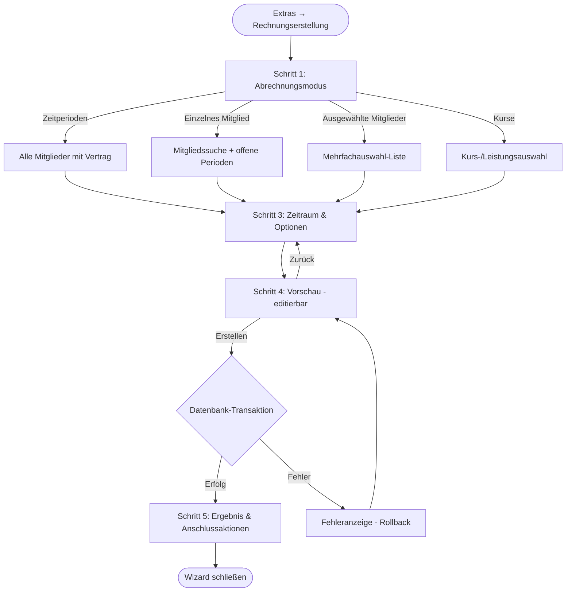
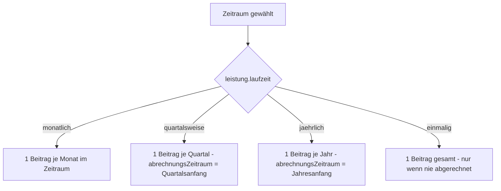
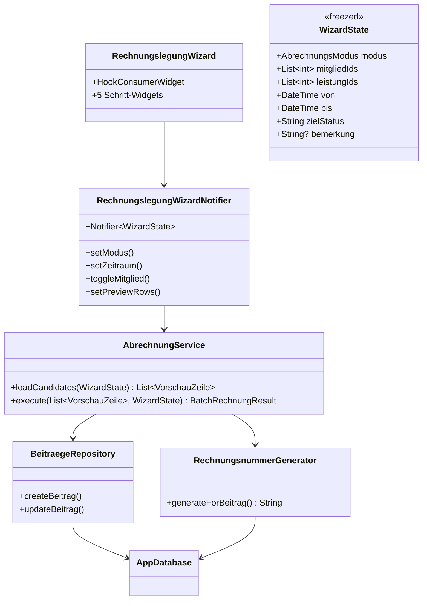
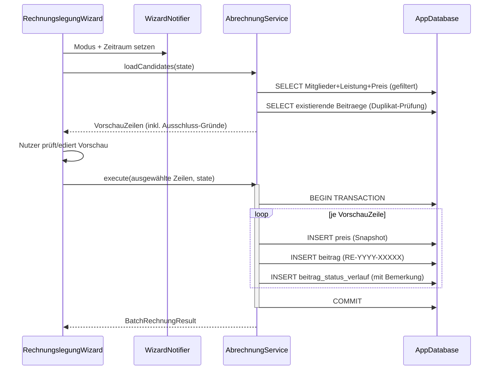
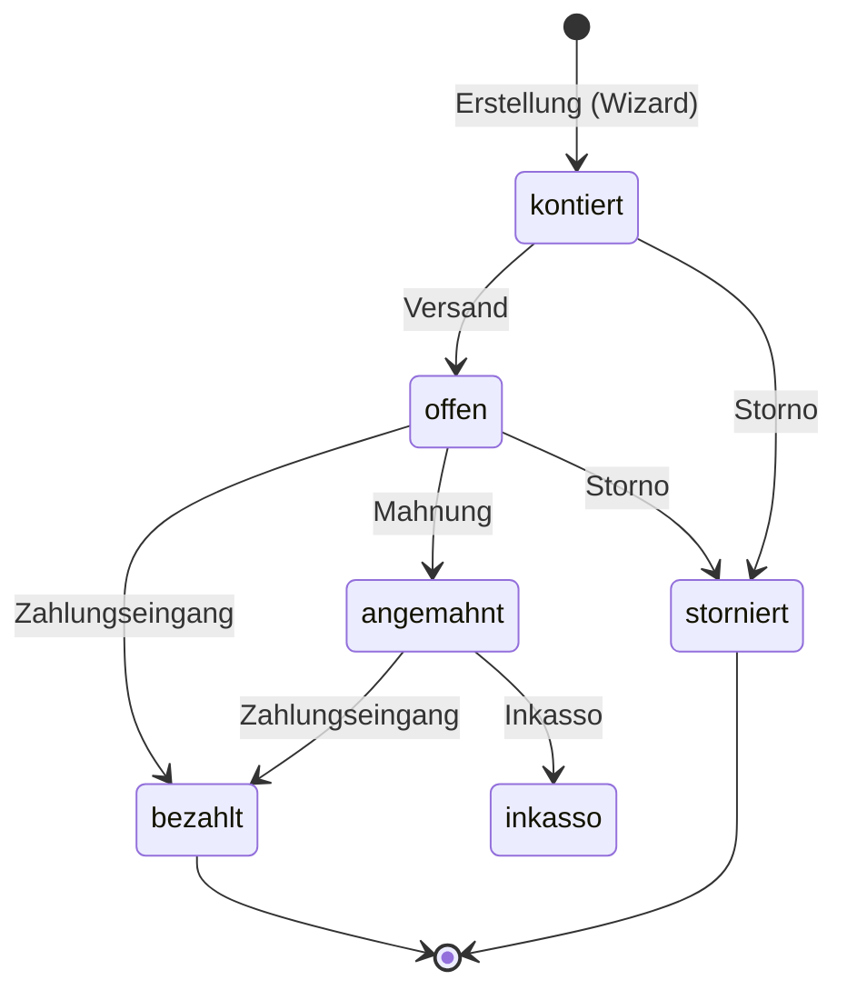

# Plan: Rechnungsstellung – Benutzerfreundlicher Rechnungsstellungs-Assistent

> **Status**: Entwurf
> **Erstellt**: 2026-10-12
> **Betroffene Menüpunkte**: Extras → Rechnungserstellung | Beiträge → Rechnungslegung
> **Voraussetzungen**: Schema-Version 17, siehe [`lib/assets/data/structur.md`](../lib/assets/data/structur.md:1)

---

## 1. Ziel

Die Rechnungsstellung für Beiträge wird an die Bedienung etablierter Rechnungssoftware
angelehnt und ermöglicht **vier Abrechnungsmodi**:

1. **Nach Zeitperioden** (Monat, Quartal, Jahr, beliebiger Zeitraum)
2. **Nach einzelnen Mitgliedern** (inkl. Abarbeitung offener Perioden)
3. **Nach ausgewählten Mitgliedern** (Mehrfachauswahl)
4. **Nach Kursen** (= Leistungen/Vertragsarten)

Kern der Verbesserung: ein **Assistent (Wizard) mit Live-Vorschau** statt zweier
unterschiedlicher, monolithischer Dialoge.

---

## 2. Recherche: Rechnungssoftware-Vergleich

> **Hinweis**: Das Context7-MCP-Tool stand in dieser Umgebung nicht zur Verfügung.
> Die Recherche basiert auf etablierten Mustern etablierter Referenzsysteme
> (sevDesk, Lexware Lexoffice, DATEV Unternehmen online, Zervant, Invoice Ninja,
> Billomat sowie Vereinssoftware wie GP-SPORT und Vereinspilot).

### 2.1 Gemeinsame UX-Muster professioneller Rechnungssoftware

| Muster | Beschreibung | ClupData heute | ClupData Soll |
|---|---|---|---|
| **Assistent (Wizard)** | Schrittweiser Ablauf: Modus → Auswahl → Optionen → Vorschau → Ausführen | Ein einstimmiger Dialog ([`BeitraegeBatchDialog`](../lib/features/rechnungserstellung/presentation/dialogs/beitraege_batch_dialog.dart:20)) + veralteter [`RechnungslegungDialog`](../lib/features/beitraege/presentation/dialogs/rechnungslegung_dialog.dart:14) | 5-Schritt-Wizard |
| **Vorschau vor Erstellung** | „Was wird erstellt?"-Liste mit Summen, Ausschlüssen, Zeilen-Auswahl | Nur Kennzahlen (Anzahl, Summe) | Vollständige, editierbare Vorschau-Tabelle |
| **Empfängerkreis-Filter** | Alle / Einzelner / Mehrfach / Kategorie (Kurs) | Nur „alle Mitglieder" + Leistungs-Filter | 4 klar benannte Modi |
| **Abrechnungszeitraum & Rhythmus** | Zeitraum-Auswahl, Rhythmus aus Vertrag (monatlich/quartalsweise/jährlich) | Monat + Quartals-Checkbox | Monat/Quartal/Jahr/Zeitraum + Rhythmus aus [`leistung.laufzeit`](../lib/core/database/tables/leistung_table.dart:19) |
| **Idempotenz sichtbar machen** | Bereits abgerechnete Positionen werden markiert, nicht still übersprungen | Stilles Überspringen (nur Zähler „übersprungen") | Sichtbare Kennzeichnung je Zeile |
| **Status-Pipeline** | Entwurf/Kontiert → Offen (versendet) → Bezahlt; Storno mit Begründung | Status-Werkzeug [`BeitragStatus`](../lib/features/beitraege/domain/models/beitrag_status.dart:1) vorhanden | Status-Ziel im Wizard wählbar |
| **Anschlussaktionen** | Direkt danach: Drucken, PDF, CSV, „Rechnungen anzeigen" | Nur „Details anzeigen" | PDF-Sammeldruck, CSV, Navigation |
| **Zahlungsziel / Fälligkeit** | Fälligkeitsdatum = Rechnung + Zahlungsziel (14/30 Tage) | Nicht im [`beitrag`-Schema](../lib/core/database/tables/beitraege_table.dart:18) | Optional, Phase 2 (siehe Kap. 8) |

### 2.2 Kernprinzipien für ClupData

1. **Vorschau vor Commit**: Es wird nichts geschrieben, bevor der Nutzer die
   konkreten Beiträge in einer Tabelle gesehen und bestätigt hat.
2. **Ein Dialog, vier Modi**: Keine konkurrierenden Einstiege mehr.
3. **Idempotenz als Feature**: Doppelabrechnungen sind technisch unmöglich
   (Duplikat-Schlüssel `mitgliedId + abrechnungsZeitraum`) und in der Vorschau sichtbar.
4. **Rhythmus-gesteuerte Perioden**: Der Vertragsrhythmus bestimmt, wie viele
   Beiträge ein Zeitraum erzeugt.

---

## 3. UX-Konzept: Der Rechnungsstellungs-Assistent

### 3.1 Wizard-Ablauf (Gesamtübersicht)



### 3.2 Schritt 1 – Abrechnungsmodus

```
┌──────────────────────────────────────────────────────────────┐
│  Beiträge abrechnen – Schritt 1 von 5                    [X] │
├──────────────────────────────────────────────────────────────┤
│                                                              │
│  ◉ Nach Zeitperioden                                         │
│    Alle Mitglieder mit gültigem Vertrag für einen Zeitraum   │
│                                                              │
│  ○ Nach einem einzelnen Mitglied                             │
│    Offene Perioden eines Mitglieds abarbeiten                │
│                                                              │
│  ○ Nach ausgewählten Mitgliedern                             │
│    Bestimmte Mitglieder gezielt auswählen                    │
│                                                              │
│  ○ Nach Kursen                                               │
│    Alle Mitglieder bestimmter Kurse/Vertragsarten            │
│                                                              │
├──────────────────────────────────────────────────────────────┤
│                                              [Weiter ▶]      │
└──────────────────────────────────────────────────────────────┘
```

### 3.3 Schritt 2 – Auswahl (modusabhängig)

| Modus | Inhalt |
|---|---|
| Zeitperioden | Keine Zusatzauswahl (Weiter zu Schritt 3) |
| Einzelnes Mitglied | Suchfeld + Ergebnisliste; Infokarte mit Vertrag, Laufzeit, Preis; Tabelle der **offenen Perioden** mit Vorauswahl (Monate, die noch nicht abgerechnet sind) |
| Ausgewählte Mitglieder | Mitgliederliste mit Checkboxen, Suche/Filter nach Name, Kurs, Vertragsstatus; „Alle auswählen"/„Auswahl aufheben" |
| Kurse | MultiSelect aller [`leistung`](../lib/core/database/tables/leistung_table.dart:12)-Datensätze (Kursname, Laufzeit/Rhythmus, Preis, Mitgliederanzahl); gruppierte Anzeige |

### 3.4 Schritt 3 – Zeitraum & Optionen

```
┌──────────────────────────────────────────────────────────────┐
│  Beiträge abrechnen – Schritt 3 von 5                    [X] │
├──────────────────────────────────────────────────────────────┤
│  ── Abrechnungszeitraum ──────────────────────────────────   │
│  │  (●) Monat      [Juni 2026 ▼]                            │
│  │  ( ) Quartal    [Q2 2026 ▼]                              │
│  │  ( ) Jahr       [2026 ▼]                                 │
│  │  ( ) Zeitraum   [von 01.01.2026] [bis 30.06.2026]        │
│  │                                                           │
│  │  Hinweis: Vertragsrhythmus erzeugt automatisch            │
│  │  die passenden Perioden (z.B. 3 Beiträge bei Quartal)     │
│  │                                                           │
│  ── Optionen ────────────────────────────────────────────    │
│  │  ☐ Nur aktive Verträge (Laufzeit bis >= heute)      [x]   │
│  │  ☐ Nur Mitglieder ohne offene/kontierte Beiträge    [ ]   │
│  │                                                           │
│  │  Status nach Erstellung:                                  │
│  │    (●) Kontiert (noch nicht versendet)                    │
│  │    ( ) Offen (zahlbar)                                    │
│  │                                                           │
│  │  Bemerkung (optional):                                    │
│  │  [Beitragserstellung Juni 2026                     ]      │
│  │                                                           │
├──────────────────────────────────────────────────────────────┤
│                            [◀ Zurück]          [Vorschau ▶]  │
└──────────────────────────────────────────────────────────────┘
```

### 3.5 Schritt 4 – Vorschau (Kernstück)

```
┌──────────────────────────────────────────────────────────────────────┐
│  Beiträge abrechnen – Schritt 4 von 5: Vorschau                  [X] │
├──────────────────────────────────────────────────────────────────────┤
│  Erstellt: 39  │  Bereits abgerechnet: 3  │  Gesamt: 3.900,00 €     │
├──────────────────────────────────────────────────────────────────────┤
│  ☑ │ Mitglied          │ Kurs/Leistung    │ Zeitraum  │ Betrag │ Info│
│  ☑ │ Mustermann, Max   │ Boxen Erwachs.   │ 06/2026   │ 45,00  │     │
│  ☑ │ Beispiel, Erika   │ Kinderkurs       │ 06/2026   │ 30,00  │     │
│  ☐ │ Schmitz, Karl     │ Boxen Erwachs.   │ 06/2026   │ 45,00  │ ¹   │
│  ☑ │ Müller, Ute       │ Fitness          │ 06/2026   │ 25,00  │ ²   │
│    │                   │                  │           │        │     │
│  ¹ bereits abgerechnet – wird nicht erstellt                       │
│  ² abweichender Einzelpreis (Mitgliedspreis)                       │
├──────────────────────────────────────────────────────────────────────┤
│  [Alle abwählen]  [Nur offene anzeigen]                             │
│                            [◀ Zurück]              [39 erstellen ▶] │
└──────────────────────────────────────────────────────────────────────┘
```

Regeln der Vorschau:

- Jede Zeile ist per Checkbox **ein-/abwählbar** (abgewählte werden nicht erstellt)
- Der **Betrag ist überschreibbar** (Preis-Snapshot: Mitgliedspreis → sonst Kurspreis)
- Bereits abgerechnete Perioden sind markiert und **per Standard abgewählt**
- Zeilen mit fehlendem Preis oder ungültigem Vertrag tragen einen Warnhinweis
- Status-Ziel und Bemerkung (aus Schritt 3) sind je Zeile sichtbar

### 3.6 Schritt 5 – Ergebnis & Anschlussaktionen

```
┌──────────────────────────────────────────────────────────────┐
│  Beiträge abrechnen – Schritt 5 von 5: Ergebnis          [X] │
├──────────────────────────────────────────────────────────────┤
│            ✅  39 Beiträge erfolgreich erstellt               │
│                                                               │
│   Erstellt:        39                                         │
│   Übersprungen:     3  (bereits abgerechnet)                  │
│   Fehler:           0                                         │
│   Gesamtbetrag:  3.900,00 €                                   │
│                                                               │
│   [Details anzeigen]                                          │
├──────────────────────────────────────────────────────────────┤
│   [Beiträge anzeigen]  [PDF-Sammeldruck]  [CSV]  [Schließen] │
└──────────────────────────────────────────────────────────────┘
```

---

## 4. Abrechnungsrhythmus & Zeitperioden

Der Rhythmus ergibt sich aus [`leistung.laufzeit`](../lib/core/database/tables/leistung_table.dart:19)
(`einmalig`, `monatlich`, `quartalsweise`, `jaehrlich`) und steuert, wie viele
Beiträge der gewählte Zeitraum erzeugt:



| Rhythmus | `abrechnungsZeitraum` | Duplikat-Schlüssel |
|---|---|---|
| `monatlich` | 1. des Monats | `mitgliedId + Monat` |
| `quartalsweise` | 1. des Quartalsanfangs | `mitgliedId + Quartal` |
| `jaehrlich` | 1. Januar (oder Vertragsmonat) | `mitgliedId + Jahr` |
| `einmalig` | Erstellungsmonat | `mitgliedId` (global, nie mehrfach) |

**Grundlage bleibt die bestehende Regel** aus
[`BeitraegeBatchService._getExistingBeitragKeys()`](../lib/features/rechnungserstellung/services/beitraege_batch_service.dart:187):
Ein Mitglied hat genau eine [`mitglied.leistung_id`](../lib/core/database/tables/mitglied_table.dart:1),
der Schlüssel `mitgliedId + abrechnungsZeitraum` bleibt erhalten und wird um die
rhythmusbasierte Periodenbildung erweitert.

---

## 5. Architektur

### 5.1 Komponenten (Zielzustand)



### 5.2 Feature-Struktur (Zielzustand)

```
lib/features/rechnungserstellung/
├── domain/models/
│   ├── abrechnungs_modus.dart          # Enum: zeitperioden, einzelnesMitglied, ausgewaehlteMitglieder, kurse
│   ├── wizard_state.dart               # @freezed Wizard-Zustand
│   ├── vorschau_zeile.dart             # Vorschauzeile inkl. Ausschluss-Grund
│   └── batch_rechnung_result.dart      # bestehend (bleibt)
├── services/
│   ├── abrechnung_service.dart         # NEU: vereinheitlicht (ersetzt BatchRechnungService + RechnungslegungService)
│   └── beitraege_batch_service.dart    # → wird aufgelöst (Logik wandert in abrechnung_service.dart)
├── presentation/
│   ├── rechnungslegung_wizard.dart     # NEU: Wizard-Dialog (Stepper)
│   ├── steps/
│   │   ├── schritt_modus.dart
│   │   ├── schritt_auswahl.dart
│   │   ├── schritt_zeitraum_optionen.dart
│   │   ├── schritt_vorschau.dart
│   │   └── schritt_ergebnis.dart
│   └── providers/
│       ├── rechnungslegung_wizard_provider.dart   # @riverpod
│       └── rechnungslegung_preview_provider.dart  # @riverpod
└── presentation/dialogs/
    └── beitraege_batch_dialog.dart     # → ENTFERNEN (durch Wizard ersetzt)
```

### 5.3 Datenfluss



---

## 6. Status-Workflow (unverändert, Referenz)



- Statuswechsel ausschließlich über
  [`updateBeitrag()`](../lib/features/beitraege/data/beitraege_repository.dart:134)
  (Status-Verlauf wird automatisch geführt, Kommentar ist Pflicht)
- Initialevinträge bei Erstellung legt der [`AbrechnungService`](#51-komponenten-zielzustand)
  analog zu [`BeitraegeBatchService`](../lib/features/rechnungserstellung/services/beitraege_batch_service.dart:147) an
- Farben ausschließlich aus
  [`beitrag_status_colors.dart`](../lib/features/beitraege/utils/beitrag_status_colors.dart:1)

---

## 7. Einstiegspunkte (eindeutig statt doppelt)

| Einstieg | Ziel | Aktion |
|---|---|---|
| Menü: Extras → Rechnungserstellung | Wizard (Modus-Auswahl) | [`main_menu_bar.dart`](../lib/common_widgets/main_menu_bar.dart:106) |
| Tastenkürzel/Toolbar | Wizard (Modus-Auswahl) | [`app_shell.dart`](../lib/common_widgets/app_shell.dart:65) |
| Beiträge → „Neu"-Menü: „Rechnungslegung" | Wizard mit vorausgewähltem Modus „Zeitperioden" | [`beitraege_screen.dart`](../lib/features/beitraege/beitraege_screen.dart:29) |

Alle drei Einstiege öffnen **denselben** Wizard – keine inkompatiblen Dialoge mehr.

---

## 8. Datenmodell

### 8.1 MVP – keine Schema-Änderung

Der Wizard arbeitet vollständig mit dem bestehenden Schema (Version 17):
[`beitrag`](../lib/core/database/tables/beitraege_table.dart:18),
[`beitrag_status_verlauf`](../lib/core/database/tables/beitrag_status_verlauf_table.dart:1),
[`preis`](../lib/core/database/tables/preis_table.dart:1) (Snapshot),
[`mitglied`](../lib/core/database/tables/mitglied_table.dart:1),
[`leistung`](../lib/core/database/tables/leistung_table.dart:1).

### 8.2 Optionale Phase 2 (eigenes ADR + Migration v18, forward-only)

| Feld | Tabelle | Typ | Zweck |
|---|---|---|---|
| `faellig_am` | `beitrag` | DATE nullable | Fälligkeitsdatum = `kontiert_am` + Zahlungsziel |
| `zahlungsziel_tage` | `stammdaten` | Schlüssel | Standard 14 Tage, überschreibbar |

**Hinweis**: Mahnwesen/`angemahnt` profitiert direkt von `faellig_am`.
Erst nach ADR und Aktualisierung der
[`structur.md`](../lib/assets/data/structur.md:1) (SSOT!) umsetzen.

---

## 9. Datenintegrität & Regeln (verbindlich)

1. **SSOT zuerst**: Jede UI-/DB-Änderung wird vor Implementierung in
   [`lib/assets/data/structur.md`](../lib/assets/data/structur.md:1) dokumentiert
2. **Transaktionen**: Die gesamte Batch-Erstellung läuft in **einer**
   `db.transaction(...)` – bei Fehler vollständiger Rollback (heute fehlt das!)
3. **Idempotenz**: Duplikat-Schlüssel `mitgliedId + abrechnungsZeitraum`,
   Vorschau zeigt bereits abgerechnete Perioden
4. **Status-Verlauf**: Jeder neue Beitrag erhält einen initialen
   [`beitrag_status_verlauf`](../lib/core/database/tables/beitrag_status_verlauf_table.dart:1)-Eintrag
   mit **verpflichtender Bemerkung**; Statusänderungen nur via
   [`updateBeitrag()`](../lib/features/beitraege/data/beitraege_repository.dart:134)
5. **Preis-Snapshot**: Kopie des Preises in [`preis`](../lib/core/database/tables/preis_table.dart:1),
   niemals Live-Referenz (bleibt wie in
   [`BeitraegeBatchService`](../lib/features/rechnungserstellung/services/beitraege_batch_service.dart:122))
6. **Rechnungsnummern**: ausschließlich via
   [`RechnungsnummerGenerator.generateForBeitrag()`](../lib/core/data/rechnungsnummer_generator.dart:20)
   (Format `RE-YYYY-XXXXX`, unique Index bleibt)
7. **FK-Regeln bleiben**: `beitrag.mitglied_id` = RESTRICT,
   `beitrag_status_verlauf.beitrag_id` = CASCADE
8. **Keine destruktiven Operationen**, Migrations forward-only
9. **Keine String-Interpolation in SQL** (Drift-Typsichere API bzw. gebundene Variablen)
10. **Statusfarben** nur aus
    [`beitrag_status_colors.dart`](../lib/features/beitraege/utils/beitrag_status_colors.dart:1)
11. **Datenschutz**: Personenbezogene Daten nur in der UI, nicht in Logs

---

## 10. Offene Entscheidungen

| # | Frage | Empfehlung |
|---|---|---|
| 1 | `faellig_am` in Phase 2 aufnehmen? | Ja, aber separates ADR + Migration v18 |
| 2 | CreateAction „Rechnungslegung" in [`beitraege_screen.dart`](../lib/features/beitraege/beitraege_screen.dart:29) behalten? | Ja, als Shortcut zum Wizard (Modus „Zeitperioden" vorausgewählt) |
| 3 | „Kurse" = [`leistung`](../lib/core/database/tables/leistung_table.dart:12)? | Ja, ohne Schema-Änderung; eigenständige `kurs`-Tabelle erst bei Bedarf des Kursplans ([`CalendarScreen`](../lib/features/calendar/calendar_screen.dart:5)) |

---

## 11. Weiterführende Dokumente

- Refactoring-Plan: [`plans/refactoring-rechnungsstellung.md`](refactoring-rechnungsstellung.md)
- ADR: [`plans/adr/ADR-001-rechnungsstellungs-assistent.md`](adr/ADR-001-rechnungsstellungs-assistent.md)
- Bestehender Batch-Plan (wird ersetzt): [`plans/rechnungbatch.md`](rechnungbatch.md)
