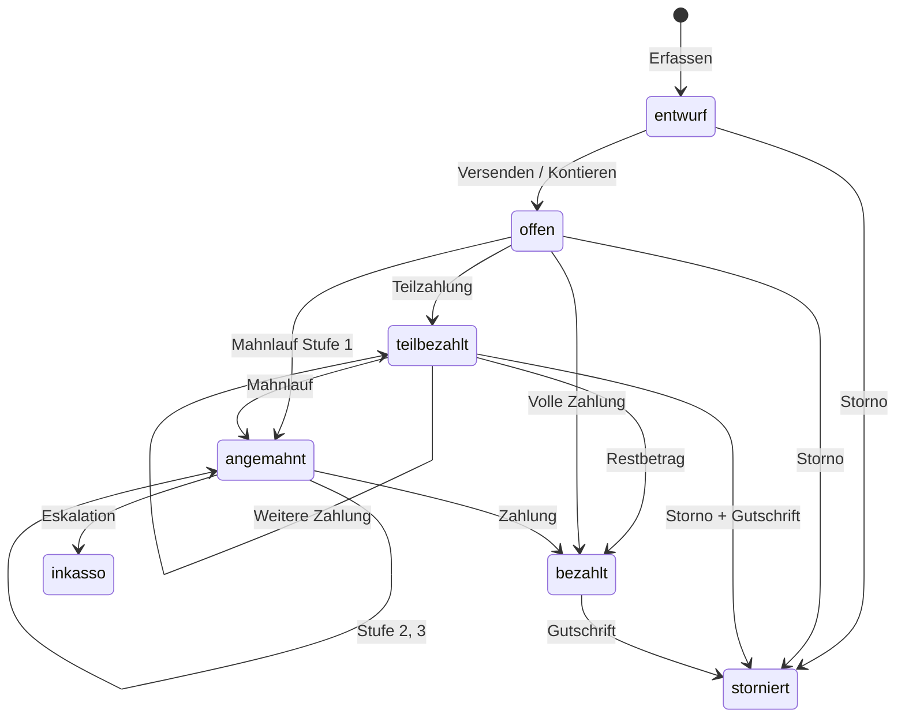
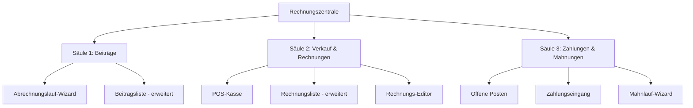
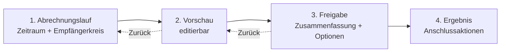
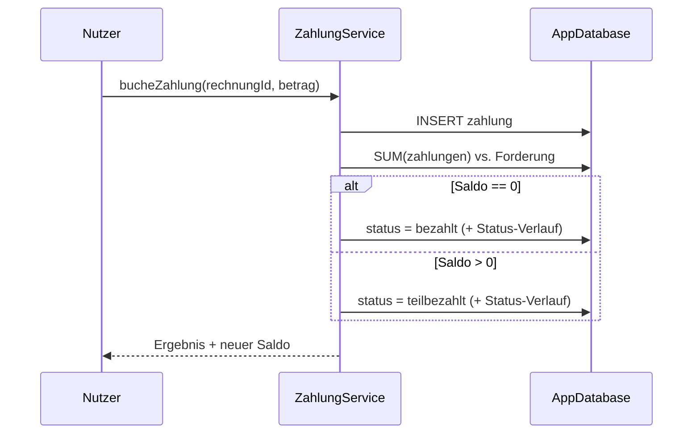
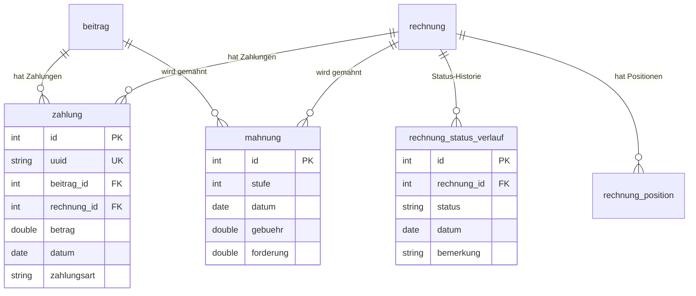
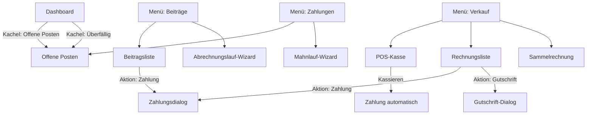
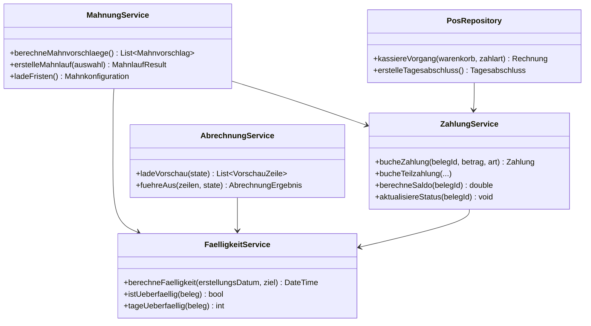
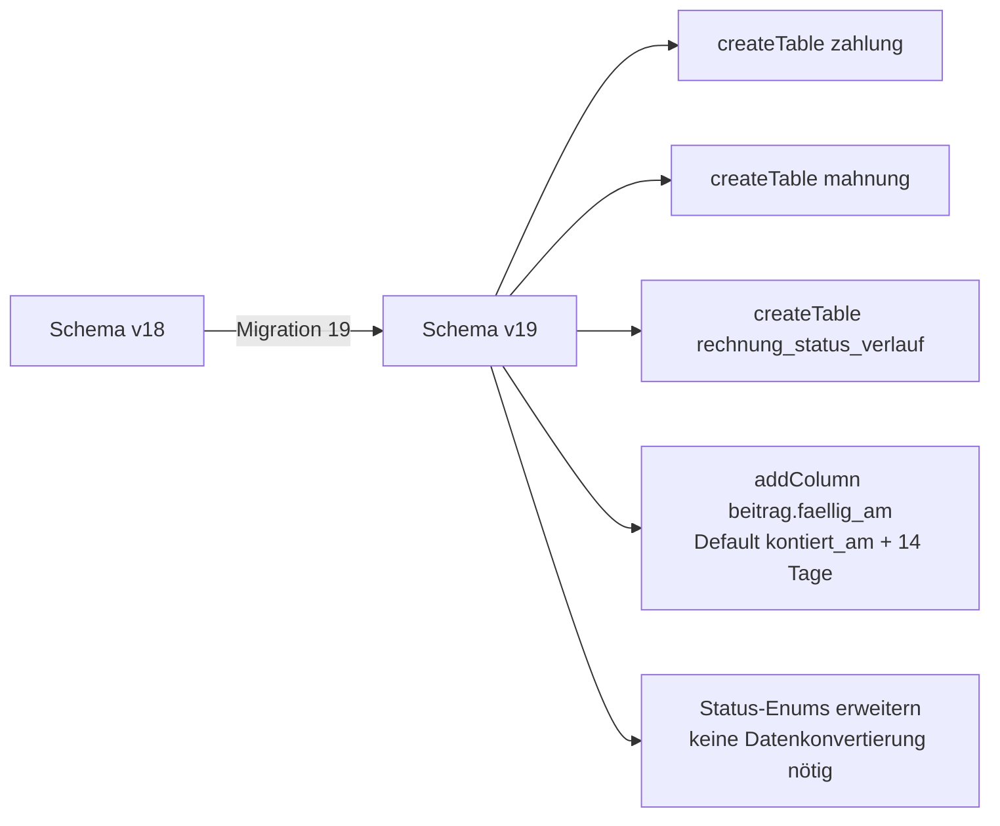

# Plan: Rechnungsstellung Redesign – Beiträge & Shop

> **Status**: Entwurf (verbindliche Planungsgrundlage für die Umsetzung)
> **Erstellt**: 2026-10-14
> **Ersetzt**: [`plans/rechnungsstellung-konzept.md`](rechnungsstellung-konzept.md:1), [`plans/rechnungbatch.md`](rechnungbatch.md:1), [`plans/refactoring-rechnungsstellung.md`](refactoring-rechnungsstellung.md:1)
> **Betroffene Bereiche**: Beiträge, Rechnungen (Waren), POS, Mahnwesen, Zahlungseingang
> **Ziel-Schema-Version**: 19 (vorher 18 = Kursplan-Tabellen, siehe [`lib/assets/data/structur.md`](../lib/assets/data/structur.md:1037))
> **ADR**: [`ADR-004`](adr/ADR-004-billing-datenmodell.md:1), [`ADR-005`](adr/ADR-005-rechnungszentrale-ui.md:1), [`ADR-006`](adr/ADR-006-mahnwesen.md:1)

---

## 1. Zielsetzung

Die Rechnungsstellung von ClupData wird als **einheitliche Billing-Domäne** neu aufgebaut:
Beitragsabrechnung, Verkaufs-/Shop-Rechnungen, Zahlungseingang und Mahnwesen greifen
auf eine gemeinsame Status-Pipeline, ein gemeinsames Zahlungsmodell und ein
konsistentes Bedienkonzept zu. Ziel ist ein **verständliches, sehr gut bedienbares UI**
nach dem Vorbild etablierter Rechnungssoftware (sevDesk, Lexoffice, KURABU,
WISO MeinVerein, ClubDesk) – ohne deren Komplexität 1:1 zu kopieren.

**Drei Kernprobleme des Ist-Zustands werden gelöst:**

1. **Fragmentierung**: Zwei getrennte Rechnungswelten ohne gemeinsame Zahlungs-/Mahnlogik
2. **Fehlende Funktionen**: Kein Zahlungseingang (Teilzahlungen), kein Mahnwesen, keine Gutschriften, kein echter POS
3. **Uneinheitliche UX**: 5-Schritt-Wizard für Beiträge, 743-Zeilen-Monolith-Dialog für Waren, Placeholder-Screen für POS

---

## 2. Ist-Analyse (Bestandsaufnahme)

### 2.1 Beitrags-Rechnungsstellung

Vorhanden: 5-Schritt-Wizard ([`lib/features/rechnungserstellung/`](../lib/features/rechnungserstellung/services/abrechnung_service.dart:11)) mit 4 Abrechnungsmodi
([`AbrechnungsModus`](../lib/features/rechnungserstellung/domain/models/abrechnungs_modus.dart:5)), Vorschau
([`VorschauZeile`](../lib/features/rechnungserstellung/domain/models/vorschau_zeile.dart:1)) und atomarer Ausführung
([`AbrechnungService.execute()`](../lib/features/rechnungserstellung/services/abrechnung_service.dart:171)).

| Aspekt | Ist-Zustand | Bewertung |
|---|---|---|
| Wizard-Ablauf | 5 Schritte: Modus → Auswahl → Zeitraum → Vorschau → Ergebnis | Zu viele Schritte für den Standardfall „Monat abrechnen" |
| Idempotenz | Duplikat-Schlüssel `mitgliedId + abrechnungsZeitraum` | ✅ Solide |
| Preis-Snapshot | Kopie in [`preis`](../lib/assets/data/structur.md:216), kein Live-Bezug | ✅ Solide |
| Fälligkeit | Fehlt – [`beitrag`](../lib/assets/data/structur.md:207) kennt kein `faellig_am` | ❌ Kein Mahnwesen möglich |
| Zahlungseingang | Fehlt – Statuswechsel nur manuell im Edit-Dialog | ❌ Keine Teilzahlungen, kein Abgleich |
| Mahnwesen | Nur Status `angemahnt` von Hand | ❌ Keine Stufen, keine Fristen |
| Anschlussaktionen | Ergebnis-Schritt mit Zählern | ⚠️ Kein PDF-Sammeldruck, kein Versand |
| Status-Pipeline | `kontiert → offen → bezahlt/angemahnt/storniert/inkasso` | ⚠️ Kein `teilbezahlt`, kein `entwurf` |

### 2.2 Verkaufs-/Shop-Rechnungsstellung

| Komponente | Ist-Zustand | Bewertung |
|---|---|---|
| [`PosScreen`](../lib/features/pos/pos_screen.dart:8) | Reiner Placeholder („Rechnungen kommen bald...") | ❌ Nichts funktionsfähig |
| [`SalesRepository`](../lib/features/pos/data/sales_repository.dart:19) | Stub mit leeren Methoden (`addSale()` tut nichts) | ❌ Nicht implementiert |
| [`NeueRechnungDialog`](../lib/features/rechnungen/widgets/neue_rechnung_dialog.dart:40) | 743 Zeilen Monolith, MwSt hart auf 19 % (Zeile 177) | ⚠️ Funktioniert, aber wartungsfeindlich |
| Sammelrechnung | In [`plans/rechnungbatch.md`](rechnungbatch.md:160) geplant, **nie implementiert** | ❌ Fehlt komplett |
| Bestandsabzug | Nicht vorhanden | ❌ Kasse ohne Bestandswirkung |
| Status-Verlauf | Fehlt für [`rechnung`](../lib/assets/data/structur.md:247) (nur [`beitrag`](../lib/assets/data/structur.md:41) hat [`beitrag_status_verlauf`](../lib/assets/data/structur.md:57)) | ❌ Keine Nachvollziehbarkeit |
| Zahlungseingang | Nur Status-Dropdown im Edit-Dialog | ❌ Keine Zahlungen, keine Teilzahlungen |

### 2.3 Gemeinsame Schwächen

- **Keine [`zahlung`](../lib/assets/data/structur.md:247)-Tabelle** → Teilzahlungen, Zahlungsabgleich (camt) und offene Posten sind unmöglich
- **Keine Fälligkeit** für Beiträge (nur [`kontiert_am`](../lib/assets/data/structur.md:219) = Erstellung)
- **Kein Mahnlauf** mit Fristen, Stufen und Gebühren
- **Keine Gutschrift/Storno-Kaskade** (Löschen statt dokumentiertem Storno)
- **Zwei Rechnungsnummern-Formate** ohne gemeinsame Auffindung ([`RE-YYYY-XXXXX`](../lib/assets/data/structur.md:915) vs. [`R-YYYY-XXXXX`](../lib/assets/data/structur.md:916))

---

## 3. Recherche: Professionelle Rechnungs-Workflows

> Recherchiert via Web-Suche (Oktober 2026). Quellen: Dunning-Best-Practices (Solidgate, Maxio, Chargebee, Paddle), Mahnwesen-Quellen (easybill, DocuSign, teamspace, rump.digital), Vereinssoftware (KURABU, WISO MeinVerein Web, ClubDesk, Clubway, vereinster, medo.core, bundaris), Invoice-Lifecycle-Dokus (Solvimon, Monite, Invoice Master), Invoicing-Best-Practices (Monograph, Bonsai, Jobber).

### 3.1 Rechnungs-Lifecycle (Branchenstandard)



**Kernmerkmale professioneller Systeme:**
- **Entwurf-Prinzip**: Rechnungen entstehen als Draft, werden geprüft und dann „versendet" (Invoice Master: *„Scheduled Drafts, not Autopilot"*)
- **Saldo-Prinzip**: Status und Restbetrag sind getrennt – Teilzahlungen ändern den Status auf `teilbezahlt`, bis der Saldo 0 ist (NetSuite/Kolleno)
- **Stornieren ≠ Löschen**: Storno erzeugt eine Gutschrift (Credit Note) und bleibt in der Historie (GoBD-Konformität)
- **Idempotenz**: Recurring-Billing vermeidet Doppelabrechnung durch Schlüssel aus Kunde + Periode

### 3.2 Mahnwesen (Dunning) – 3-Stufen-Standard

| Stufe | Auslöser (nach Fälligkeit) | Inhalt | Gebühr (üblich) |
|---|---|---|---|
| Zahlungserinnerung | +7 Tage | Freundlich, „Unschuldsvermutung" | keine |
| 1. Mahnung | +14 Tage | Deutlicher, Zahlungsziel 10–14 Tage | 1–5 € |
| 2. Mahnung | +21 Tage | Letzte Frist 7 Tage, Drohung Inkasso | 5–10 € |
| Inkasso/Eskalation | +30 Tage | Übergabe, Verzugszinsen (§ 288 BGB) | manuell |

Quellen-Belege: Fristen 7/14/21 Tage (rump.digital), 1. Mahnung +14 Tage Frist, dann Verkürzung auf 10/7 Tage (DocuSign), 3-Stufen-Verfahren mit Eskalation (easybill, teamspace). Verzugszinsen: 5 % über Basiszinssatz (B2C) bzw. 9 % (B2C) gem. § 288 BGB.

### 3.3 Beitragsabrechnung im Verein (Vereinssoftware-Standard)

- **Vertragsabrechnung**: Vertrag/Beitragsklasse einmalig definieren → automatische Rechnungsstellung im Rhythmus (Clubway: *„Vertragsabrechnung"*, KURABU, medo.core)
- **Beitragsklassen** mit Betrag und Intervall (monatlich/quartalsweise/jährlich) – entspricht [`leistung.laufzeit`](../lib/assets/data/structur.md:219)
- **SEPA-Einzug**: pain.008-XML, Pre-Notification, Mandatsverwaltung, Rücklastschrift → Mandat deaktivieren + Mahnstufe eskalieren (vereinster, KURABU)
- **Zahlungsabgleich**: camt.053-Kontoauszug-Import, automatische Zuordnung → Statuswechsel
- **Rücklastschrift-Behandlung**: automatisch `offen` + Mahnstufe + Benachrichtigung

> **Übertrag auf ClupData**: Die bestehende Periodenlogik ([`AbrechnungService.loadVorschau()`](../lib/features/rechnungserstellung/services/abrechnung_service.dart:47)) entspricht bereits der Vertragsabrechnung. Es fehlen Fälligkeit, Zahlungseingang und Mahnwesen. SEPA-Export ist **Phase 4** (nur Schnittstelle vorsehen).

### 3.4 POS & Verkauf

- **Walk-in vs. Mitglied**: Rechnung kann Kunde ohne Mitgliedschaft haben ([`rechnung.mitglied_id`](../lib/assets/data/structur.md:255) erlaubt NULL) – bestehendes Schema ist korrekt
- **Kassenvorgang ≠ Rechnungsstellung**: POS-Buchung = sofort bezahlt (Bar/Karte) + Bestandsabzug; Rechnungsstellung = `offen` ohne Bestandsabzug (siehe ADR in [`plans/rechnungbatch.md`](rechnungbatch.md:398))
- **Sammelrechnung**: Mehrere Verkäufe eines Mitglieds zu einer Rechnung zusammenfassen (KURABU/ClubDesk-Muster)

---

## 4. Ziel-Konzept: Die drei Säulen der Rechnungszentrale



### 4.1 Säule 1 – Beitragsabrechnung (Abrechnungslauf)

Der bestehende 5-Schritt-Wizard wird zu einem **4-Schritt-Abrechnungslauf** verschlankt:



**Schritt 1 – Abrechnungslauf** (kombiniert Modus + Zeitraum in einer Ansicht):

```
┌────────────────────────────────────────────────────────────────────┐
│  Beiträge abrechnen – Schritt 1 von 4                         [X] │
├────────────────────────────────────────────────────────────────────┤
│                                                                    │
│  ── Empfängerkreis ────────────────────────────────────────────    │
│  [Alle Mitglieder] [Nach Kurs ▾] [Mitglieder wählen] [Einzelnes]   │
│   ▲ aktiv                                                           │
│   42 Mitglieder mit gültigem Vertrag                               │
│                                                                    │
│  ── Abrechnungszeitraum ──────────────────────────────────────    │
│  (●) Monat        [Juni 2026 ▼]                                   │
│  ( ) Quartal      [Q2 2026 ▼]                                     │
│  ( ) Jahr         [2026 ▼]                                        │
│  ( ) Zeitraum     [von 01.01.2026] [bis 30.06.2026]               │
│                                                                    │
│  ℹ Vertragsrhythmus erzeugt automatisch die passenden Perioden    │
│                                                                    │
├────────────────────────────────────────────────────────────────────┤
│                                              [Vorschau berechnen ▶]│
└────────────────────────────────────────────────────────────────────┘
```

- **Empfängerkreis als Chip-Leiste** statt eigenem Wizard-Schritt → 2 Klicks bis zur Vorschau
- Standardfall „Alle Mitglieder, laufender Monat" erfordert **genau 2 Klicks** (Öffnen → Vorschau)

**Schritt 2 – Vorschau (Kernstück, editierbar):**

```
┌──────────────────────────────────────────────────────────────────────────┐
│  Beiträge abrechnen – Schritt 2 von 4: Vorschau                      [X] │
├──────────────────────────────────────────────────────────────────────────┤
│  ✅ Erstellen: 39   ⏭ Bereits abgerechnet: 3   ⚠ Ohne Preis: 1          │
│  Summe zu erstellen: 3.900,00 €                                          │
├──────────────────────────────────────────────────────────────────────────┤
│  ☑ │ Mitglied          │ Leistung       │ Zeitraum │ Betrag  │ Fällig  │  │
│  ☑ │ Mustermann, Max   │ Boxen Erwachs. │ 06/2026  │ 45,00 € │ 30.06.  │  │
│  ☑ │ Beispiel, Erika   │ Kinderkurs     │ 06/2026  │ 30,00 € │ 30.06.  │  │
│  ☐ │ Schmitz, Karl     │ Boxen Erwachs. │ 06/2026  │ 45,00 € │  ¹      │  │
│  ☑ │ Müller, Ute       │ Fitness        │ 06/2026  │ 25,00 € │  ²      │  │
│  ☐ │ Weber, Tom        │ Boxen Jugend   │ 06/2026  │  --     │  ³      │  │
├──────────────────────────────────────────────────────────────────────────┤
│  ¹ bereits abgerechnet – wird nicht erstellt                              │
│  ² abweichender Einzelpreis (Mitgliedspreis) – Betrag editierbar          │
│  ³ kein Preis hinterlegt – Betrag manuell eintragen oder ausschließen     │
├──────────────────────────────────────────────────────────────────────────┤
│  [Alle auswählen] [Nur zu erstellende] [Beträge bearbeiten]              │
│                              [◀ Zurück]              [39 übernehmen ▶]    │
└──────────────────────────────────────────────────────────────────────────┘
```

- **Betrag pro Zeile editierbar** (Doppelklick oder Bearbeiten-Icon) – ersetzt den separaten [`betrag_edit_dialog.dart`](../lib/features/rechnungserstellung/presentation/steps/betrag_edit_dialog.dart:1)
- **Fälligkeit je Zeile sichtbar** (neu: `faellig_am`, siehe Kapitel 5)
- Zeilen mit fehlendem Preis werden **sichtbar ausgeschlossen** statt still übersprungen

**Schritt 3 – Freigabe:**

```
┌────────────────────────────────────────────────────────────────────┐
│  Beiträge abrechnen – Schritt 3 von 4: Freigabe                [X] │
├────────────────────────────────────────────────────────────────────┤
│  Zusammenfassung                                                   │
│   39 Beiträge · 3.900,00 € · Fällig 30.06.2026 · 14 Tage Ziel     │
│                                                                    │
│  Status nach Erstellung:                                           │
│   ( ) Entwurf  – noch nicht versendet, weiter bearbeitbar          │
│   (●) Offen    – zahlbar, Fälligkeit aktiv                        │
│                                                                    │
│  Zahlungsziel: (●) 14 Tage  ( ) 30 Tage  ( ) individuell          │
│                                                                    │
│  Bemerkung (Pflicht für Status-Verlauf):                           │
│  [Beitragsabrechnung Juni 2026                              ]      │
│                                                                    │
│  ☑ PDF-Sammeldruck nach Erstellung vorbereiten                     │
├────────────────────────────────────────────────────────────────────┤
│                        [◀ Zurück]        [39 Beiträge erstellen ▶] │
└────────────────────────────────────────────────────────────────────┘
```

**Schritt 4 – Ergebnis & Anschlussaktionen** (unverändert im Geiste, erweitert):

```
┌────────────────────────────────────────────────────────────────────┐
│  Beiträge abrechnen – Schritt 4 von 4: Ergebnis                [X] │
├────────────────────────────────────────────────────────────────────┤
│            ✅  39 Beiträge erfolgreich erstellt                    │
│   Erstellt: 39   Übersprungen: 3   Fehler: 0   Summe: 3.900,00 €  │
├────────────────────────────────────────────────────────────────────┤
│  [Beiträge anzeigen]  [PDF-Sammeldruck]  [CSV]  [Nächsten Monat]  │
│  [Schließen]                                                        │
└────────────────────────────────────────────────────────────────────┘
```

### 4.2 Säule 2 – Verkauf & Rechnungen

#### 4.2.1 POS-Kasse (ersetzt [`PosScreen`](../lib/features/pos/pos_screen.dart:8))

```
┌────────────────────────────────────────────────────────────────────────────┐
│  🛒 Kasse                                                     [Kasse zu]  │
├──────────────────────────────────────────────────────┬─────────────────────┤
│  Produkte                                            │  Warenkorb          │
│  [Suche: ___________]  [Alle ▾]                      │  ─────────────────  │
│                                                      │  2× Proteinriegel    │
│  ┌──────────┐ ┌──────────┐ ┌──────────┐              │        5,00 €       │
│  │ Protein- │ │ Trink-   │ │ Hand-    │              │  1× Boxhandschuhe   │
│  │ riegel   │ │ flasche  │ │ schuhe   │              │       45,00 €       │
│  │  2,50 €  │ │ 15,00 €  │ │ 89,00 €  │              │  ─────────────────  │
│  └──────────┘ └──────────┘ └──────────┘              │  Summe:    50,00 €  │
│  ┌──────────┐ ┌──────────┐ ┌──────────┐              │                     │
│  │ ...      │ │ ...      │ │ ...      │              │  Kunde: [Mitglied ▾] │
│  └──────────┘ └──────────┘ └──────────┘              │  Walk-in [Name____] │
│                                                      │                     │
│                                                      │  Zahlart:           │
│                                                      │  (●) Bar ( ) Karte  │
│                                                      │  ( ) Rechnung       │
│                                                      ├─────────────────────┤
│                                                      │  [🧾 Kassieren 50€] │
└──────────────────────────────────────────────────────┴─────────────────────┘
```

**Regeln der Kasse:**
- **Bar/Karte** → erzeugt [`rechnung`](../lib/assets/data/structur.md:247) mit Status `bezahlt` + [`zahlung`](#51-neue-tabelle-zahlung)-Eintrag + **Bestandsabzug**
- **Rechnung** → erzeugt `rechnung` mit Status `offen` + Fälligkeit (+14 Tage), **kein** Bestandsabzug (Rechnungsstellung ≠ Kassenvorgang)
- Mitglied oder Walk-in pro Vorgang wählbar
- **Tagesabschluss** (Kassenbericht): Summen je Zahlart, exportierbar als CSV/PDF

#### 4.2.2 Rechnungs-Editor (ersetzt [`NeueRechnungDialog`](../lib/features/rechnungen/widgets/neue_rechnung_dialog.dart:40))

- Aufgeteilt in [`RechnungEditorDialog`](../lib/features/rechnungen/widgets/neue_rechnung_dialog.dart:40) (Kopf) + [`PositionEditor`](../lib/features/rechnungen/widgets/neue_rechnung_dialog.dart:17) (Zeilen) – **kein 743-Zeilen-Monolith mehr**
- **MwSt-Satz je Position** wählbar (7 % / 19 % / 0 %) statt hart kodiert 19 %
- Positionen aus [`waren`](../lib/assets/data/structur.md:364) oder **freie Textposition**
- **Sammelrechnung**: offene Verkäufe eines Mitglieds zusammenfassen → eine Rechnung (ersetzt den nie implementierten Dialog 2 aus [`plans/rechnungbatch.md`](rechnungbatch.md:160))
- **Duplizieren** („Kopie erstellen") und **Gutschrift** (siehe 4.4) als Aktionen

### 4.3 Säule 3 – Zahlungen & Mahnungen

#### 4.3.1 Offene Posten (zentrale Ansicht)

```
┌────────────────────────────────────────────────────────────────────────────┐
│  Offene Posten · 12 Rechnungen · 1.847,50 € offen · 4 überfällig           │
├────────────────────────────────────────────────────────────────────────────┤
│  🔍 [Name/Nummer suchen...]  [Alle ▾] [Überfällig ▾] [Beiträge|Rechnungen]│
├────────────────────────────────────────────────────────────────────────────┤
│  Nr.          Kunde/Beitrag      Fällig      Saldo     Status   Aktionen   │
│  RE-2026-0142 Mustermann, Max   30.06.2026   45,00 €   ⚠ +5T   [Zahlung]  │
│  R-2026-0031  Beispiel, Erika   14.07.2026  120,00 €   ⏳ ok    [Zahlung]  │
│  RE-2026-0143 Schmitz, Karl     30.06.2026   30,00 €   🔴 +18T  [Mahnung]  │
│  ...                                                                        │
├────────────────────────────────────────────────────────────────────────────┤
│  [Zahlung erfassen]  [Mahnlauf starten]  [PDF-Sammeldruck]  [CSV]          │
└────────────────────────────────────────────────────────────────────────────┘
```

- Zeigt **alle** offenen [`beitrag`](../lib/assets/data/structur.md:207)- und [`rechnung`](../lib/assets/data/structur.md:247)-Datensätze mit Saldo > 0
- Sortierung standardmäßig nach Überfälligkeit
- Überfälligkeit = `faellig_am` + tolerierte Frist (Stammdaten-konfigurierbar, Default 0 Tage)

#### 4.3.2 Zahlungseingang

```
┌────────────────────────────────────────────────────────────────────┐
│  Zahlung erfassen – RE-2026-0142 · Mustermann, Max            [X] │
├────────────────────────────────────────────────────────────────────┤
│  Offener Betrag: 45,00 €                                           │
│                                                                    │
│  Zahlbetrag:  [45,00        ]  €   [Teilzahlung?]                 │
│  Datum:       [14.06.2026   ]                                      │
│  Zahlart:     (●) Überweisung ( ) Bar ( ) Lastschrift ( ) Karte    │
│  Bemerkung:   [Überweisung Juni                              ]     │
├────────────────────────────────────────────────────────────────────┤
│                          [Abbrechen]            [Zahlung buchen ▶] │
└────────────────────────────────────────────────────────────────────┘
```

**Automatische Status-Kaskade** (via [`ZahlungService`](#72-services)):



#### 4.3.3 Mahnlauf-Wizard

```
┌────────────────────────────────────────────────────────────────────────────┐
│  Mahnlauf – Schritt 1 von 3: Überfällige auswählen                    [X] │
├────────────────────────────────────────────────────────────────────────────┤
│  Fristenregel: [Standard: 7 / 14 / 21 Tage ▾]                            │
│  ☑ │ Nr.          Kunde            Fällig      Saldo    Vorschlag         │
│  ☑ │ RE-2026-0143 Schmitz, Karl    30.06.2026  30,00 €  2. Mahnung (+5€)  │
│  ☑ │ RE-2026-0140 Weber, Tom       15.06.2026  45,00 €  1. Mahnung (+2€)  │
│  ☐ │ R-2026-0028  Müller, Ute      31.05.2026  80,00 €  3. Mahnung (+8€)  │
├────────────────────────────────────────────────────────────────────────────┤
│  [Alle auswählen]            [◀ Zurück]            [Vorschau berechnen ▶]  │
└────────────────────────────────────────────────────────────────────────────┘
```

Schritt 2: Vorschau der Mahnschreiben (Summen, Gebühren, Textvorlage) · Schritt 3: Erstellen (Status `angemahnt`, [`mahnung`](#53-neue-tabelle-mahnung)-Eintrag, PDF-Ausgabe) – Details in [`ADR-006`](adr/ADR-006-mahnwesen.md:1).

### 4.4 Storno & Gutschrift (Credit Note)

- **Stornieren** erzeugt einen negativen Beleg (Gutschrift) mit Bezug zur Originalrechnung
- Statuswechsel zu `storniert` + [`status_verlauf`](../lib/assets/data/structur.md:407)-Eintrag mit Begründung (Pflicht)
- Gutschrift erhält eigene Nummer: `G-YYYY-XXXXX` (neues Format, dritte Serie)
- Bereits gezahlte Beträge werden über eine negative [`zahlung`](#51-neue-tabelle-zahlung) ausgeglichen
- **Nie löschen** – GoBD/Nachvollziehbarkeit (siehe [`ADR-004`](adr/ADR-004-billing-datenmodell.md:1))

---

## 5. Datenmodell (Schema-Version 18)

### 5.1 NEUE Tabelle: `zahlung`

_Zahlungseingänge zu Beiträgen oder Rechnungen (auch Teilzahlungen und Gutschrift-Ausgleiche)._

| Feld | Typ | Constraints | Beschreibung |
|---|---|---|---|
| `id` | INTEGER | PK, AutoIncrement | |
| `uuid` | TEXT | NotNull, Unique | Instanzunabhängig (CSV) |
| `beitrag_id` | INTEGER | FK→beitrag.id (CASCADE) | Genau EINES von `beitrag_id`/`rechnung_id` |
| `rechnung_id` | INTEGER | FK→rechnung.id (CASCADE) | s.o. |
| `betrag` | REAL | NotNull | Positiv = Zahlung, negativ = Gutschrift-Ausgleich |
| `datum` | DATE | NotNull | Zahlungsdatum |
| `zahlungsart` | TEXT | NotNull, Enum:[bar, karte, lastschrift, ueberweisung, sonstiges] | |
| `bemerkung` | TEXT | Nullable | |
| `created_at` | DATE | NotNull | |

**Constraints:** `CHECK ((beitrag_id IS NULL) != (rechnung_id IS NULL))` · `idx_zahlung_beitrag`, `idx_zahlung_rechnung`, `idx_zahlung_uuid`

### 5.2 NEUE Tabelle: `rechnung_status_verlauf`

_Analog [`beitrag_status_verlauf`](../lib/assets/data/structur.md:57) für Waren-Rechnungen – versionierte Status-Historie._

| Feld | Typ | Constraints | Beschreibung |
|---|---|---|---|
| `id` | INTEGER | PK, AutoIncrement | |
| `uuid` | TEXT | NotNull, Unique | |
| `rechnung_id` | INTEGER | FK→rechnung.id (CASCADE) | |
| `status` | TEXT | NotNull | Neuer Status |
| `datum` | DATE | NotNull | |
| `bemerkung` | TEXT | **NotNull** | Erklärung ist Pflicht (wie Beiträge) |

### 5.3 NEUE Tabelle: `mahnung`

_Dokumentierte Mahnstufen je Forderung._

| Feld | Typ | Constraints | Beschreibung |
|---|---|---|---|
| `id` | INTEGER | PK, AutoIncrement | |
| `uuid` | TEXT | NotNull, Unique | |
| `beitrag_id` | INTEGER | FK→beitrag.id (CASCADE) | Genau EINES der beiden FKs |
| `rechnung_id` | INTEGER | FK→rechnung.id (CASCADE) | |
| `stufe` | INTEGER | NotNull | 1 = Zahlungserinnerung, 2 = 1. Mahnung, 3 = 2. Mahnung, 4 = Inkasso |
| `datum` | DATE | NotNull | |
| `gebuehr` | REAL | NotNull, Default 0 | Mahngebühr |
| `forderung` | REAL | NotNull | Offener Betrag zum Mahnzeitpunkt |
| `bemerkung` | TEXT | Nullable | |

### 5.4 Geänderte Tabellen

| Tabelle | Änderung | Begründung |
|---|---|---|
| [`beitrag`](../lib/assets/data/structur.md:207) | `+ faellig_am` DATE NotNull (Default: `kontiert_am + 14 Tage`) | Grundlage Mahnwesen |
| [`rechnung`](../lib/assets/data/structur.md:247) | `status` Enum erweitert: `+ entwurf, teilbezahlt, angemahnt` | Lifecycle nach Branchenstandard |
| [`beitrag`](../lib/assets/data/structur.md:207) | `status` Enum erweitert: `+ teilbezahlt` | Teilzahlungen |

> **Status-Enum Beiträge (neu)**: `entwurf` (neu, optional) → `kontiert` → `offen` → `teilbezahlt` → `bezahlt`; `angemahnt`, `inkasso`, `storniert`. Bestehende Werte bleiben gültig – reine Erweiterung.
> **Status-Enum Rechnungen (neu)**: `entwurf`, `offen`, `teilbezahlt`, `bezahlt`, `angemahnt`, `storniert` (bisher: `offen`, `bezahlt`, `storniert`).

### 5.5 ER-Diagramm (Ergänzungen)



### 5.6 Rechnungsnummern (erweitert)

| Belegart | Format | Generator |
|---|---|---|
| Beitrag | `RE-YYYY-XXXXX` | `RechnungsnummerGenerator.generateForBeitrag()` |
| Rechnung (Waren) | `R-YYYY-XXXXX` | `RechnungsnummerGenerator.generateForRechnung()` |
| Gutschrift (neu) | `G-YYYY-XXXXX` | `RechnungsnummerGenerator.generateForGutschrift()` – neu |

### 5.7 Stammdaten-Erweiterungen (Mahnkonfiguration)

Neue Schlüssel in [`stammdaten`](../lib/assets/data/structur.md:41):

| Schlüssel | Default | Beschreibung |
|---|---|---|
| `mahnstufe1_frist_tage` | 7 | Tage nach Fälligkeit → Zahlungserinnerung |
| `mahnstufe2_frist_tage` | 14 | → 1. Mahnung |
| `mahnstufe3_frist_tage` | 21 | → 2. Mahnung |
| `mahngebuehr_stufe2` | 2.00 | Gebühr 1. Mahnung (€) |
| `mahngebuehr_stufe3` | 5.00 | Gebühr 2. Mahnung (€) |
| `zahlungsziel_tage` | 14 | Standard-Zahlungsziel bei Erstellung |
| `toleranz_tage_ueberfaellig` | 0 | Schonfrist bis „überfällig" |

---

## 6. UI/UX-Konzept

### 6.1 Informationsarchitektur



### 6.2 Gestaltungsprinzipien (verbindlich)

1. **2-Klick-Standardfall**: Häufigste Aktion (Monat abrechnen, Kassieren) ≤ 2 Interaktionen
2. **Editierbare Vorschau vor jedem Commit** – nichts wird geschrieben, bevor die Vorschau bestätigt ist
3. **Saldo immer sichtbar** – offene Beträge und Fälligkeit in jeder Liste
4. **Aktionen kontextsensitiv** – Buttons je Zeile (Zahlung/Mahnung/Storno) statt globaler Menüs
5. **Statusfarben zentral** – [`beitrag_status_colors.dart`](../lib/features/beitraege/utils/beitrag_status_colors.dart:1) + [`rechnung_status_colors.dart`](../lib/features/rechnungen/utils/rechnung_status_colors.dart:1) gemeinsam nutzen; `teilbezahlt` = Hellblau `#BBDEFB`, `entwurf` = Hellgrau `#F5F5F5`
6. **Formularfelder** [`app_text_field.dart`](../lib/common_widgets/forms/app_text_field.dart:1), [`app_date_picker_field.dart`](../lib/common_widgets/forms/app_date_picker_field.dart:1), [`app_dropdown_field.dart`](../lib/common_widgets/forms/app_dropdown_field.dart:1) – kein Eigenbau
7. **Keine Hex-Codes hart codiert** – nur über Farb-Utils

---

## 7. Architektur

### 7.1 Feature-Struktur (Zielzustand)

```
lib/features/
├── billing/                          # NEU: gemeinsame Billing-Domäne
│   ├── data/
│   │   ├── zahlung_repository.dart
│   │   ├── mahnung_repository.dart
│   │   └── offene_posten_repository.dart
│   ├── domain/models/
│   │   ├── zahlung.dart
│   │   ├── mahnung.dart
│   │   ├── offener_posten.dart        # Union: Beitrag|Rechnung mit Saldo
│   │   ├── zahlungsart.dart
│   │   └── mahnvorschlag.dart
│   ├── services/
│   │   ├── zahlung_service.dart       # Zahlung buchen, Saldo, Status-Kaskade
│   │   ├── mahnung_service.dart       # Fristen, Vorschläge, Mahnlauf
│   │   └── faelligkeit_service.dart   # Fälligkeit + Überfälligkeit
│   ├── presentation/
│   │   ├── offene_posten_screen.dart
│   │   ├── widgets/
│   │   │   ├── zahlung_eingang_dialog.dart
│   │   │   ├── offene_posten_grid.dart
│   │   │   └── saldo_badge.dart
│   │   ├── mahnlauf/
│   │   │   ├── mahnlauf_wizard.dart
│   │   │   └── steps/
│   │   └── providers/
│   └── utils/billing_status_colors.dart
├── abrechnung/                       # NEU (ersetzt rechnungserstellung)
│   ├── data/abrechnung_service.dart   # Periodenlogik aus abrechnung_service.dart
│   ├── domain/models/
│   │   ├── abrechnungslauf_state.dart # @freezed (ersetzt wizard_state.dart)
│   │   ├── vorschau_zeile.dart
│   │   └── abrechnung_ergebnis.dart
│   ├── presentation/
│   │   ├── abrechnungslauf_wizard.dart
│   │   ├── steps/
│   │   └── providers/
│   └── abrechnung_service.dart
├── pos/                              # UMGEBAUT: echte Kasse
│   ├── data/pos_repository.dart       # Vorgang + Bestandsabzug + Tagesabschluss
│   ├── presentation/pos_screen.dart
│   ├── widgets/
│   │   ├── produkt_grid.dart
│   │   ├── warenkorb_panel.dart
│   │   └── tagesabschluss_dialog.dart
│   └── providers/
├── rechnungen/                       # ERWEITERT
│   ├── data/rechnungen_repository.dart
│   ├── widgets/
│   │   ├── rechnung_editor_dialog.dart  # schlank, nutzt PositionEditor
│   │   ├── position_editor.dart
│   │   ├── sammelrechnung_dialog.dart
│   │   └── gutschrift_dialog.dart
│   └── ...
├── beitraege/                        # ERWEITERT
│   ├── widgets/beitrag_zahlung_auswahl.dart
│   └── ...
└── ...
```

### 7.2 Services (Kernlogik)



- **[`ZahlungService`](#72-services)**: einzige Stelle, die [`zahlung`](#51-neue-tabelle-zahlung) schreibt + Status-Kaskade auslöst
- **[`MahnungService`](#72-services)**: liest offene Posten, berechnet Vorschläge aus [`stammdaten`](#57-stammdaten-erweiterungen-mahnkonfiguration)-Fristen
- **[`AbrechnungService`](#72-services)**: übernimmt die bewährte Periodenlogik aus [`abrechnung_service.dart`](../lib/features/rechnungserstellung/services/abrechnung_service.dart:47) (Idempotenz-Schlüssel, Preis-Snapshot, Savepoint-Transaktion) unverändert

### 7.3 Dependency-Injection (Riverpod)

- `zahlungRepositoryProvider`, `mahnungRepositoryProvider`, `offenePostenRepositoryProvider` (`@riverpod`)
- `zahlungServiceProvider`, `mahnungServiceProvider` (`@riverpod`) – erhalten `AppDatabase` via [`appDatabaseProvider`](../lib/core/providers/1)
- Repositories über Konstruktor-Injection, kein Service-Locator

---

## 8. Migration & Entfernung der alten Rechnungsstellung

### 8.1 Zu entfernende Komponenten

| Datei/Ablage | Aktion | Ersetzer |
|---|---|---|
| [`lib/features/rechnungserstellung/`](../lib/features/rechnungserstellung/services/abrechnung_service.dart:1) (komplettes Feature) | **Löschen** | `lib/features/abrechnung/` |
| [`lib/features/pos/pos_screen.dart`](../lib/features/pos/pos_screen.dart:8) | **Ersetzen** | neue POS-Kasse |
| [`lib/features/pos/data/sales_repository.dart`](../lib/features/pos/data/sales_repository.dart:1) | **Löschen** | `pos_repository.dart` |
| [`lib/features/rechnungen/widgets/neue_rechnung_dialog.dart`](../lib/features/rechnungen/widgets/neue_rechnung_dialog.dart:40) | **Ersetzen** | `rechnung_editor_dialog.dart` + `position_editor.dart` |
| [`plans/rechnungsstellung-konzept.md`](rechnungsstellung-konzept.md:1) | Status „ersetzt" markieren | dieses Dokument |
| [`plans/rechnungbatch.md`](rechnungbatch.md:1) | Status „ersetzt" markieren | dieses Dokument |
| [`plans/refactoring-rechnungsstellung.md`](refactoring-rechnungsstellung.md:1) | Status „ersetzt" markieren | dieses Dokument |

> **Hinweis**: Die Periodenlogik aus [`AbrechnungService`](../lib/features/rechnungserstellung/services/abrechnung_service.dart:35) wird **nicht neu geschrieben**, sondern nach `lib/features/abrechnung/data/abrechnung_service.dart` migriert (Copy + Anpassung der Imports). Die Idempotenz- und Transaktionslogik ist getestet und bewährt.

### 8.2 DB-Migration v17 → v18



- **Additiv, forward-only** – keine `deleteTable`, keine Datenverluste (Regel aus [`AGENTS.md`](../AGENTS.md:1))
- `faellig_am` wird bei bestehenden Beiträgen mit `kontiert_am + 14 Tage` befüllt
- Bestehende Status-Werte bleiben gültig
- Nach Migration: `flutter pub run build_runner build -d` (Pflicht, siehe [`AGENTS.md`](../AGENTS.md:1))

### 8.3 SSOT-Pflege

Jede Schema-/UI-Änderung wird **vor** der Implementierung in [`lib/assets/data/structur.md`](../lib/assets/data/structur.md:1) dokumentiert (Kapitel 1.11–1.13 für neue Tabellen, Kapitel 4 für neue Screens, Kapitel 7 erweitert).

---

## 9. Umsetzungsplan (Phasen)

| Phase | Inhalt | Abhängigkeit | Aufwand |
|---|---|---|---|
| **Phase 1** | Datenmodell v18: [`zahlung`](#51-neue-tabelle-zahlung), [`mahnung`](#53-neue-tabelle-mahnung), [`rechnung_status_verlauf`](#52-neue-tabelle-rechnung_status_verlauf), `beitrag.faellig_am`, Migration | – | mittel |
| **Phase 2** | [`billing`](#71-feature-struktur-zielzustand)-Core: [`zahlung_service`](#72-services), [`faelligkeit_service`](#72-services), Offene-Posten-Screen, Zahlungsdialog | Phase 1 | mittel |
| **Phase 3** | [`abrechnung`](#71-feature-struktur-zielzustand)-Feature: 4-Schritt-Abrechnungslauf (Migrierung der Periodenlogik), Entfernung [`rechnungserstellung`](#81-zu-entfernende-komponenten) | Phase 2 | mittel |
| **Phase 4** | POS-Kasse + [`rechnungen`](#71-feature-struktur-zielzustand)-Editor (aufgeteilt) + Sammelrechnung + Gutschrift | Phase 2 | hoch |
| **Phase 5** | Mahnlauf-Wizard + PDF-Mahnvorlagen | Phase 2 | mittel |
| **Phase 6** | Tagesabschluss, Dashboard-Kacheln, Feinschliff UX | Phase 3–5 | gering |

**Empfehlung**: Phasen 1–3 zuerst (Beitrags-Workflow komplett), dann Phase 4 (Verkauf), dann 5–6.

---

## 10. Risiken & offene Fragen

| Risiko | Gegenmaßnahme |
|---|---|
| Status-Enum-Erweiterung bricht bestehende Auswertungen | Nur additive Werte; alte Werte bleiben lesbar; [`beitrag_status_colors.dart`](../lib/features/beitraege/utils/beitrag_status_colors.dart:1) wird erweitert, nicht ersetzt |
| Periodenlogik-Verlust beim Feature-Umzug | 1:1-Migration + bestehende Tests mit übernehmen ([`test/features/`](../test/features/backup/backup_scheduler_test.dart:1)) |
| MwSt-Umstellung (7 %/19 %) ändert Preis-Snapshot-Verhalten | Netto-Preise werden beim Snapshot berechnet; bestehende Rechnungen unverändert |
| SEPA-Anbindung überfordert Umfang | **Explizit Phase 4+ / separat** – nur Schnittstelle (`zahlungsart: lastschrift`) vorsehen |

**Offene Fragen an den Fachbereich:**
1. Soll `entwurf` als Beitrags-Status zusätzlich zu `kontiert` eingeführt werden? (Vorschlag: Nein – `kontiert` bleibt der Entwurf-Zustand)
2. Mahngebühren-Höhe und Fristen – Default-Werte aus Kapitel 5.7 bestätigen/anpassen
3. Ist ein SEPA-XML-Export (pain.008) mittelfristig gewünscht? Dann [`zahlung`](#51-neue-tabelle-zahlung)-Schema bereits mandatsfähig halten (ist es durch `zahlungsart`)

---

## 11. Zusammenfassung

| Aspekt | Vorher | Nachher |
|---|---|---|
| Beitrags-Wizard | 5 Schritte, Modi versteckt | 4 Schritte, Empfängerkreis als Chips, 2-Klick-Standardfall |
| Zahlungseingang | fehlt | Teilzahlungen + Status-Kaskade |
| Mahnwesen | manueller Status | 3-Stufen-Mahnlauf mit Fristen & Gebühren |
| POS | Placeholder | echte Kasse mit Bestandsabzug & Tagesabschluss |
| Waren-Rechnung | 743-Zeilen-Dialog | aufgeteilter Editor + Sammelrechnung + Gutschrift |
| Status-Historie | nur Beiträge | auch Rechnungen |
| Fälligkeit | fehlt | `faellig_am` überall |
